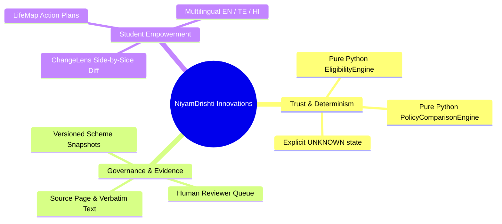

# Key Innovations

## Short Explanation

NiyamDrishti stands apart from ordinary scholarship listing websites and generic AI wrappers by combining **deterministic rule execution**, **versioned policy diffing**, and **evidence-backed human review**.

---

## 1. Core Architectural & Product Innovations

| Innovation | How It Works in NiyamDrishti | Why It Matters |
|---|---|---|
| **1. AI Extracts, Pure Python Decides** | `OpenAIProvider.extract_structured()` outputs Pydantic-validated JSONB rules; `EligibilityEngine` evaluates them with pure Python (`OPERATOR_MAP`) | Eliminates LLM hallucinations in pass/fail eligibility decisions while keeping document parsing automated |
| **2. ChangeLens Policy Diffing** | `PolicyComparisonEngine` indexes approved rules by `(rule_category, rule_key)` across two `SchemeVersion` records and classifies `added` / `removed` / `modified` changes by severity (`high` / `medium` / `low`) | Students and institutions immediately see *what changed* between policy versions instead of re-reading 40-page PDFs |
| **3. Mandatory Human-in-the-Loop Gate** | Every extracted `SchemeRule` defaults to `review_status="pending"`. Both `eligibility/evaluate` and `policy-comparisons` filter strictly on `review_status == "approved"` | Prevents unverified AI extraction errors from reaching students |
| **4. Explicit `UNKNOWN` vs. `FAILED` Semantics** | Missing profile fields return `EligibilityResult.UNKNOWN` and populate `missing_fields` rather than marking a student ineligible | Avoids discouraging students due to incomplete profiles and guides them on which field to fill |
| **5. Page-Level Evidence Anchoring** | `SchemeRule` and `PolicyChangeEvent` store `source_text`, `source_page`, and `confidence` alongside structured JSONB conditions | Every rule and policy change can be audited directly against the official notification |
| **6. Prompt-Injection-Hardened Document Parsing** | `OpenAIProvider.extract_structured()` wraps input documents in `<document>...</document>` tags with explicit instructions to treat document text strictly as data | Protects against adversarial instructions embedded inside uploaded third-party PDFs or web text |
| **7. Cross-Dialect JSONB Portability** | `app/database/types.py` defines a custom `JSONB` `TypeDecorator` using PostgreSQL `JSONB` in production and `JSON` on SQLite | Enables fast, zero-external-DB unit and API tests via `sqlite+aiosqlite:///:memory:` |

---

## 2. Innovation Map

---

## Related Documentation

- [ChangeLens](../02-product/CHANGELENS.md)
- [Eligibility Engine](../02-product/ELIGIBILITY_ENGINE.md)
- [Human-in-the-Loop](../06-ai-and-intelligence/HUMAN_IN_THE_LOOP.md)
- [Technical Differentiation](../11-hackathon/TECHNICAL_DIFFERENTIATION.md)

