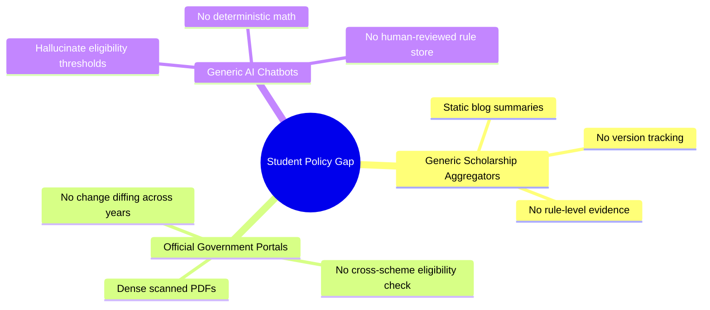

# Problem Statement

## Short Explanation

Millions of Indian students rely on state and central government scholarships, fellowships, and fee-reimbursement schemes to continue higher education—yet the official rules governing these benefits are trapped in complex, frequently updated documents that students struggle to interpret accurately.

---

## 1. The Information & Policy Gap

Across Andhra Pradesh, Telangana, and Central ministries, financial aid is governed by official notifications, Government Orders (GOs), and periodic amendments. Students face five compounding barriers:

1. **Fragmented Discovery**: Schemes are scattered across separate portals (e.g., AP social welfare portals, Telangana ePass, National Scholarship Portal, PMRF), making cross-scheme comparison time-consuming.
2. **Dense, Unstructured Notifications**: Eligibility thresholds (annual family income, minimum marks/CGPA, domicile years, caste category, course type, age cutoffs) are buried inside multi-page PDFs or scanned circulars.
3. **Silent Rule Changes**: When a scheme updates an income ceiling, raises a marks cutoff, shifts a deadline, or removes an eligible course, portals rarely highlight what changed compared to the prior year.
4. **No Personalized Impact Visibility**: Even when a student reads a revised notification, translating legalistic amendments into *"Am I still eligible?"* is error-prone.
5. **High Risk of AI Hallucination in Generic Chatbots**: Asking a general-purpose LLM *"Am I eligible for Scheme X?"* risks fabricated thresholds, outdated dates, or false reassurance—unacceptable for life-affecting financial decisions.

---

## 2. Why Existing Solutions Fall Short

---

## 3. Target Impact of Solving This Problem

By separating **AI document structuring** (verified by human reviewers) from **deterministic Python rule evaluation and version comparison**, NiyamDrishti aims to give students:

- **Zero-guesswork eligibility checks** with exact criterion-by-criterion explanations.
- **Transparent policy diffs (ChangeLens)** showing every added, removed, or modified rule with source page evidence.
- **Actionable next steps (LifeMap)** instead of leaving students with raw PDFs.

---

## Related Documentation

- [Project Overview](PROJECT_OVERVIEW.md)
- [Objectives and Scope](OBJECTIVES_AND_SCOPE.md)
- [Key Innovations](KEY_INNOVATIONS.md)
- [Expected Impact](../11-hackathon/EXPECTED_IMPACT.md)

