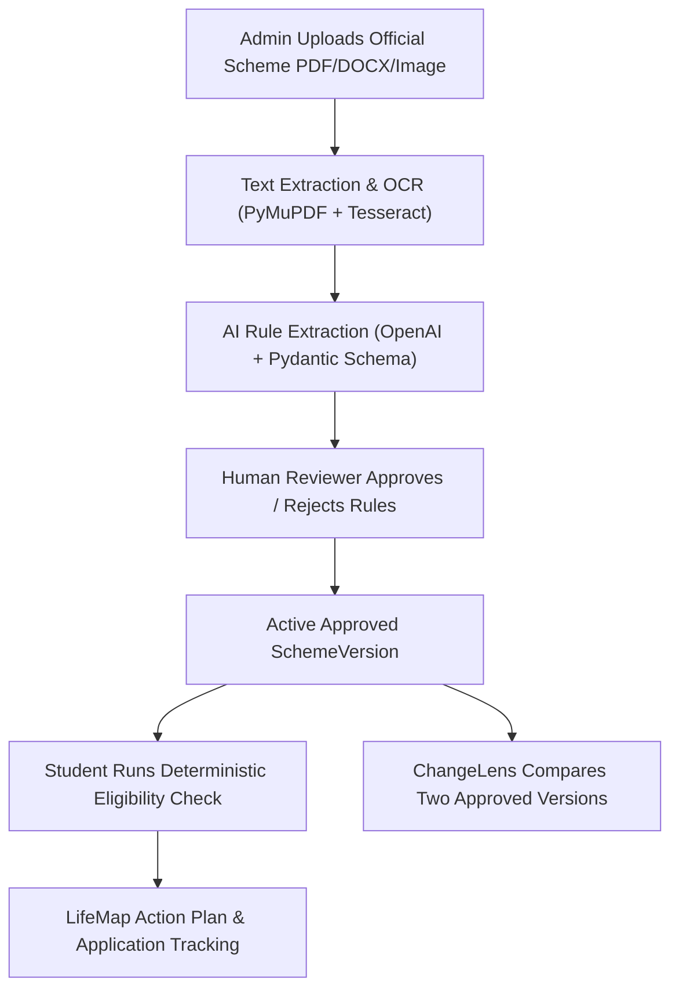

# Project Overview

**NiyamDrishti** ("Rule Vision") is an AI-powered government policy intelligence and personalized student opportunity platform built to help students across **Andhra Pradesh, Telangana, and Central/All-India schemes** discover eligible scholarships, understand exactly what changes when government notifications are revised, and follow structured action plans.

---

## 1. Why This Platform Exists

Government scholarship and welfare portals publish eligibility criteria inside dense PDFs, Government Orders (GOs), circulars, and gazettes—often spanning dozens of pages and changing every academic year. Students frequently miss opportunities or submit invalid applications because they cannot tell:

1. Which schemes match their exact academic, income, domicile, and category profile.
2. What changed between last year's notification and this year's revision.
3. Whether a specific policy amendment made them newly eligible or newly ineligible.

---

## 2. What Problem It Solves

| Challenge | Traditional Scholarship Portals | NiyamDrishti Approach |
|---|---|---|
| **Static Listings** | Show raw PDF links or generic summaries | Extracts structured JSONB rules linked to `source_text` and `source_page` |
| **Opaque Eligibility** | Students guess if they qualify | Deterministic Python `EligibilityEngine` returns `passed` / `failed` / `unknown` per criterion |
| **Unnoticed Policy Updates** | Silent PDF replacements on government websites | **ChangeLens** computes structured `added` / `removed` / `modified` diffs between versions |
| **Personalized Impact** | No mapping from policy change to individual student | **Impact Engine** models (`StudentImpact`) track old vs. new eligibility per student |
| **Overwhelming Next Steps** | No guidance after reading a scheme | **LifeMap** creates structured action plans and manual application status tracking |
| **Language Barriers** | Complex English or bureaucratic jargon | **AI Assistant** supports English, Telugu (`te`), and Hindi (`hi`) explanations |

---

## 3. High-Level Workflow

---

## 4. Core Capabilities (Implemented vs. Planned)

- **Implemented Core**: Next.js 16 frontend UI, FastAPI modular backend, 22-table SQLAlchemy 2.0 schema, Supabase Auth JWT validation & 5-role RBAC, deterministic `EligibilityEngine` (with a known bug on compound rules), deterministic `PolicyComparisonEngine`, scheme discovery & bookmarking, reviewer approval queue, application tracker, and OpenAI-backed multilingual chat.
- **Partially Implemented / In Progress**: Background document processing worker (`app/workers/__init__.py` is currently empty), Supabase Storage file uploads, automatic `StudentImpact` batch computation, RAG vector retrieval for AI Assistant citations, and resolving frontend–backend endpoint contract mismatches.
- **Planned**: Anthropic Claude provider implementation, Redis caching/rate limiting, email/SMS notifications, PDF report exports, and College Coordinator dashboard pages.

---

## 5. Related Documentation

- [Problem Statement](PROBLEM_STATEMENT.md)
- [Objectives and Scope](OBJECTIVES_AND_SCOPE.md)
- [Key Innovations](KEY_INNOVATIONS.md)
- [Project Audit](../PROJECT_AUDIT.md)
- [System Architecture](../03-architecture/SYSTEM_ARCHITECTURE.md)

