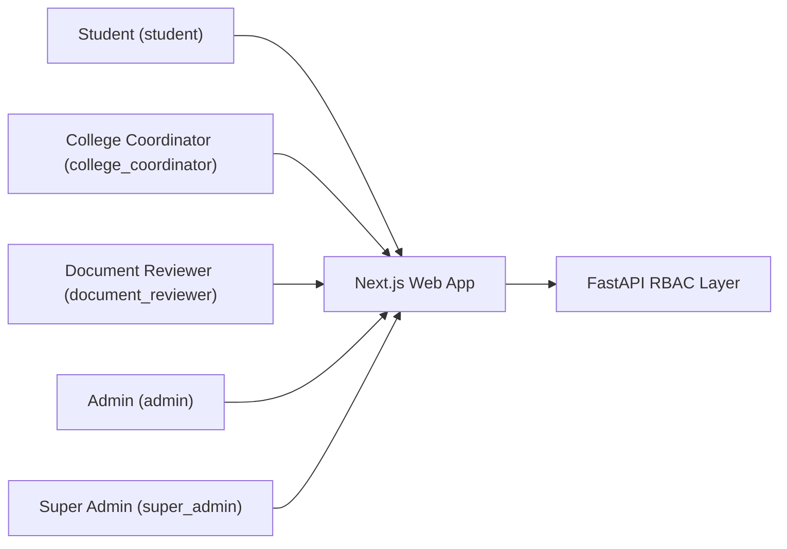

# Target Users

## Short Explanation

NiyamDrishti serves five distinct user roles defined in `backend/app/core/permissions.py` (`AppRole`) and `frontend/src/types/index.ts`, spanning both scholarship applicants and institutional/platform operators.

---

## 1. User Personas & Platform Roles

| Role (`AppRole`) | Hierarchy Level (`RoleChecker`) | Primary Needs | Current Implementation Support |
|---|---|---|---|
| **Student** (`student`) | 1 | Discover scholarships, check deterministic eligibility, inspect policy changes, manage LifeMap action plans, track manual applications, ask AI Assistant | Implemented across `/dashboard`, `/schemes`, `/eligibility`, `/changelens`, `/lifemap`, `/applications`, `/assistant`, `/settings/profile` (note: some endpoint contracts need alignment) |
| **College Coordinator** (`college_coordinator`) | 2 | Support students within an affiliated institution (`College`, `CollegeMembership`) | Database models and RBAC constants implemented; `/coordinator` frontend page and backend coordinator endpoints not yet built |
| **Document Reviewer** (`document_reviewer`) | 3 | Verify AI-extracted eligibility rules against verbatim `source_text` and `source_page`, approve/reject rules, trigger ChangeLens comparisons | Implemented: `/reviewer` UI + `GET /reviews/queue`, `POST /reviews/{rule_id}/approve`, `POST /policy-comparisons` |
| **Admin** (`admin`) | 4 | Create/edit/publish schemes, upload official notifications, monitor system health & processing jobs, review rules | Backend endpoints implemented (`/admin/schemes`, `/documents/upload`, `/admin/system-health`); `/admin` overview page exists; `/admin/*` subpages not yet built |
| **Super Admin** (`super_admin`) | 5 | Full platform administration including user/role management and invitations (`AdminInvitation`) | RBAC role defined; `/admin/users` subpage and user-role management API endpoints not yet built |

---

## 2. Primary Beneficiary: Indian Students

Students from **10th, 12th, Undergraduate (UG), Postgraduate (PG), and PhD** levels—particularly first-generation college applicants and students from Andhra Pradesh and Telangana—benefit from:

- **Clarity without legal jargon**: Plain explanations of why a criterion passed, failed, or needs profile data (`unknown`).
- **Regional language support**: English, Telugu (`te`), and Hindi (`hi`) support in user preferences (`preferred_language`) and AI Assistant prompts.
- **Privacy-conscious profile**: Optional caste category (`Prefer not to say`) and explicit avoidance of Aadhaar/bank details.

---

## Related Documentation

- [Role-Based Access Control](../04-technical/ROLE_BASED_ACCESS_CONTROL.md)
- [Student Journey](../02-product/STUDENT_JOURNEY.md)
- [Admin Workflow](../02-product/ADMIN_WORKFLOW.md)
- [Document Review Workflow](../02-product/DOCUMENT_REVIEW_WORKFLOW.md)

