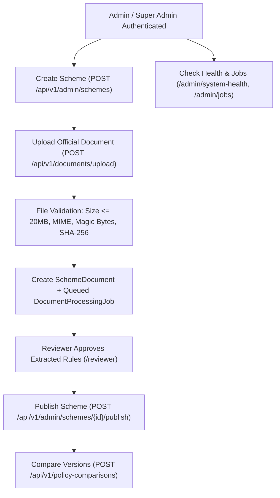

# Admin Workflow

## Short Explanation

The Admin Workflow empowers platform administrators (`admin` and `super_admin`) to create and publish schemes, upload official notification documents, trigger ChangeLens comparisons, and monitor system health.

---

## 1. Why This Module Exists & What Problem It Solves

Government schemes cannot rely on crowdsourced or unverified edits. Admins provide controlled curation: registering authoritative scheme metadata, uploading official GOs/notifications, and publishing schemes only after rules are extracted and verified.

---

## 2. Admin Workflow Diagram

---

## 3. Technical Implementation

### Backend Endpoints & Permissions

All admin operations are guarded by `require_roles("admin", "super_admin")` in `backend/app/core/security.py`:

| Operation | Method & Path | Module | Implementation Notes |
|---|---|---|---|
| Create scheme | `POST /api/v1/admin/schemes` | `schemes/router.py` | Generates unique slug via `_slugify()`; sets `is_published=False` |
| Update scheme | `PATCH /api/v1/admin/schemes/{scheme_id}` | `schemes/router.py` | Partial update via `SchemeUpdateRequest` |
| Publish scheme | `POST /api/v1/admin/schemes/{scheme_id}/publish` | `schemes/router.py` | Sets `Scheme.is_published = True` |
| Upload official document | `POST /api/v1/documents/upload` | `documents/router.py` | Validates file, saves `SchemeDocument` + `DocumentProcessingJob` |
| Compare versions | `POST /api/v1/policy-comparisons` | `changelens/router.py` | Permitted for `admin`, `super_admin`, `document_reviewer` |
| System health | `GET /api/v1/admin/system-health` | `monitoring/router.py` | Returns static `{"status": "ok", "database": "connected", ...}` |
| Job list | `GET /api/v1/admin/jobs` | `monitoring/router.py` | Stub returning `{"jobs": [], "message": "..."}` |

### Frontend Admin Shell (`frontend/src/app/admin/page.tsx`)

- Fetches `GET /admin/system-health` and renders status indicators.
- Displays 4 navigation cards linking to:
  - `/admin/schemes` (Scheme Management)
  - `/admin/documents` (Document Management)
  - `/admin/jobs` (Processing Jobs)
  - `/admin/users` (User Management — Super Admin)

---

## 4. Error Handling & Security

- Non-admin users hitting `/admin*` in the frontend are redirected to `/dashboard` by `frontend/src/middleware.ts`.
- Non-admin API requests receive HTTP `403 Forbidden` from `RoleChecker`.
- Invalid document uploads (oversized, disallowed MIME, or mismatched magic bytes) return HTTP `422 Unprocessable Entity`.

---

## 5. Current Implementation Status & Gaps

- **Backend**: Scheme CRUD/publish and document metadata/job creation work. However, `POST /documents/upload` does **not** upload file bytes to Supabase Storage, `app/workers/__init__.py` is empty (jobs stay `queued`), `admin/jobs` is a stub, and no user-management (`admin/users`) endpoints exist yet.
- **Frontend**: `/admin` overview page is implemented, but the 4 linked subpages (`/admin/schemes`, `/admin/documents`, `/admin/jobs`, `/admin/users`) do not exist in `frontend/src/app/` yet.

---

## 6. Related Documentation

- [Document Review Workflow](DOCUMENT_REVIEW_WORKFLOW.md)
- [Document Processing](../03-architecture/DOCUMENT_PROCESSING.md)
- [Role-Based Access Control](../04-technical/ROLE_BASED_ACCESS_CONTROL.md)

