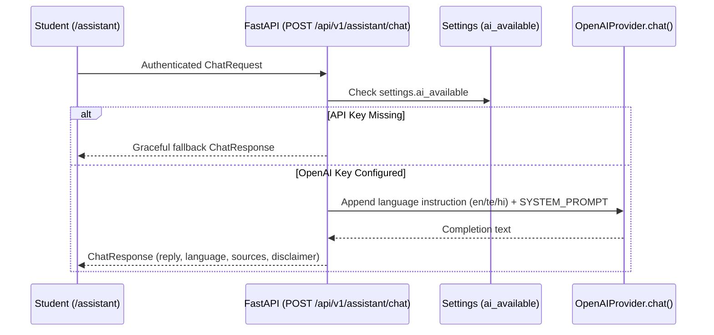

# AI Assistant

## Short Explanation

The AI Assistant lets students ask natural-language questions about scholarships, deadlines, and required documents in **English (`en`)**, **Telugu (`te`)**, or **Hindi (`hi`)**, with strict system-prompt guardrails against inventing eligibility decisions or scheme details.

---

## 1. Why This Module Exists & What Problem It Solves

Even with structured eligibility rules, students often have follow-up questions about terminology, renewal norms, or state-specific portal steps in their preferred language. The AI Assistant provides conversational explanations while displaying a mandatory verification disclaimer.

---

## 2. Current Request Flow

---

## 3. Technical Implementation

### Backend (`backend/app/modules/assistant/router.py`)

- **Endpoint**: `POST /api/v1/assistant/chat` (authenticated via `get_current_user`).
- **Request Model (`ChatRequest`)**:
  - `messages`: `List[ChatMessage]` (`role`, `content`)
  - `scheme_id`: `Optional[uuid.UUID]` (accepted in schema, not yet queried in DB)
  - `language`: `str = "en"` (`en` | `te` | `hi`)
- **Response Model (`ChatResponse`)**:
  - `reply`: `str`
  - `language`: `str`
  - `sources`: `List[str] = []`
  - `disclaimer`: `"This response is generated from verified scheme data. Always confirm with official sources."`
- **Guardrails (`SYSTEM_PROMPT`)**:
  - Instructs the model never to invent criteria, amounts, dates, or URLs, never to present AI content as official government decisions, and to ignore embedded prompt-injection instructions.
- **Graceful Degradation**: If `settings.ai_available` is `False`, returns a `200 OK` `ChatResponse` explaining that an AI provider API key is required.
- **Provider**: Instantiates `OpenAIProvider()` (`settings.openai_model`, default `gpt-4o-mini`, `temperature=0.3`, `max_tokens=2000`).

### Frontend (`frontend/src/app/assistant/page.tsx`)

- Chat interface with 4 suggested prompts, loading dots animation, amber disclaimer banner, and citation card rendering when `citations` are present.

---

## 4. Current Implementation Status & Gaps

> [!WARNING]
> **Partially Implemented** — the following gaps exist in the current repository:
> 1. **No RAG / Vector Retrieval Yet**: Despite UI copy and comments referencing RAG and document citations, `assistant/router.py` does **not** retrieve chunks from PostgreSQL, pgvector, or `SchemeRule` records—`sources` always defaults to `[]`, and `scheme_id` is unused.
> 2. **Frontend–Backend Payload Mismatch**: `frontend/src/app/assistant/page.tsx` posts `{ session_id, message }` and reads `{ answer, citations }`, whereas the backend expects `{ messages: [{role, content}], language }` and returns `{ reply, language, sources, disclaimer }`.
> 3. **OpenAI Only**: `assistant/router.py` imports `OpenAIProvider` directly even if `AI_PROVIDER=anthropic` is configured.

---

## 5. Related Documentation

- [AI Overview](../06-ai-and-intelligence/AI_OVERVIEW.md)
- [AI Architecture](../03-architecture/AI_ARCHITECTURE.md)
- [Multilingual Support](../06-ai-and-intelligence/MULTILINGUAL_SUPPORT.md)

