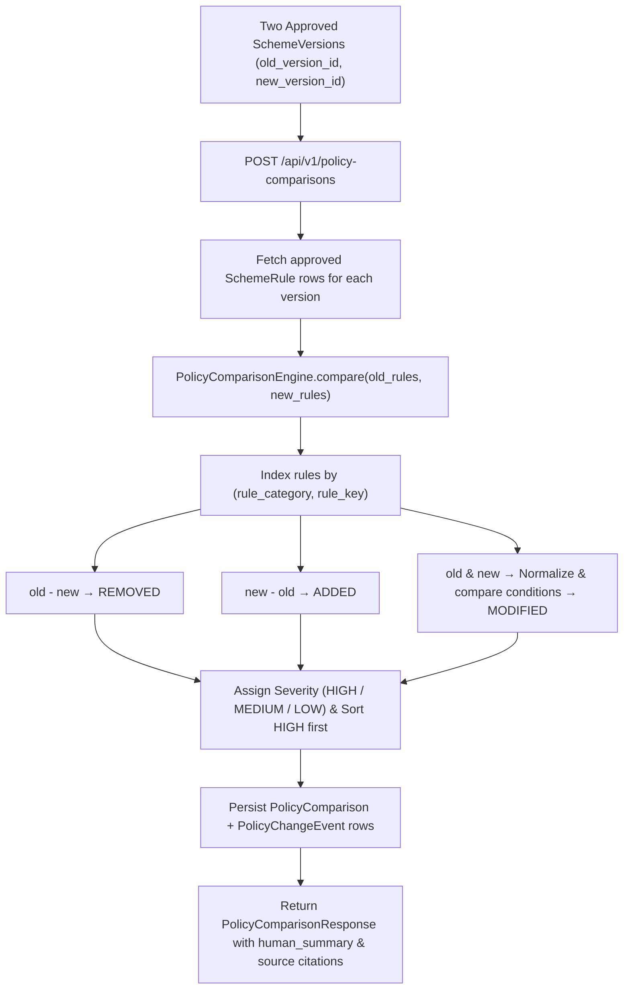

# ChangeLens — Policy Version Comparison

## Short Explanation

**ChangeLens** is NiyamDrishti's policy diffing engine. When a government department issues a new notification or amendment for an existing scheme, ChangeLens compares the approved rules of the old version against the new version and highlights every **added**, **removed**, and **modified** requirement with severity ratings and source-page evidence.

---

## 1. Why This Module Exists & What Problem It Solves

Scholarship rules shift silently from year to year: an income limit might increase from ₹2,50,000 to ₹3,00,000, a minimum marks threshold might rise from 50% to 60%, or an application deadline might move up. Reading two 30-page PDFs side by side to spot these edits is tedious and error-prone. ChangeLens turns policy updates into a clear, structured changelog.

---

## 2. Workflow Diagram

---

## 3. Technical Implementation

### Core Engine (`backend/app/modules/changelens/comparison_engine.py`)

`PolicyComparisonEngine` is **pure Python**—it makes zero LLM calls:

- **Indexing**: Rules are keyed by `(rule_category, rule_key)`.
- **Normalization (`_normalize_condition`)**: Ignores the `note` field (so cosmetic note wording changes do not trigger false diffs), converts numeric values to strings, sorts lists, and lowercases/strips strings.
- **Severity Classification (`_severity`)**:
  - `HIGH`: `income`, `marks`, `cgpa`, `age`, `category`, `disability`, `domicile`, `state`, `exclusion`
  - `MEDIUM`: `amount`, `deadline`
  - `LOW`: All other categories (e.g., `document`, `renewal`, `other`)
- **Output Sorting**: Changes are sorted `HIGH` → `MEDIUM` → `LOW`.
- **Human Summaries**: `_summary_added`, `_summary_removed`, and `_summary_modified` generate concise explanations (e.g., `Changed 'income' (income): 250000 → 300000`).

### Backend API (`backend/app/modules/changelens/router.py`)

- `POST /api/v1/policy-comparisons` (roles: `admin`, `super_admin`, `document_reviewer`): Validates both versions belong to `scheme_id`, loads only `review_status == "approved"` rules, runs `comparison_engine.compare()`, and saves `PolicyComparison` + `PolicyChangeEvent` records.
- `GET /api/v1/policy-comparisons/{comparison_id}` (authenticated): Retrieves a saved comparison and its change events.

### Frontend (`frontend/src/app/changelens/page.tsx` & `change-event-card.tsx`)

- Provides a scheme selector dropdown and renders each change via `ChangeEventCard` with color-coded `ADDED` / `REMOVED` / `MODIFIED` banners, severity badge, Previous vs. Updated condition boxes, and collapsible source text.

---

## 4. Input and Output Example (Illustrative Demo Data)

> [!NOTE]
> The following example uses illustrative synthetic rule sets matching the unit tests in `backend/tests/test_comparison_engine.py`.

**Input (`old_rules` vs. `new_rules`):**
- Old: `("income", "income") -> {"operator": "lte", "value": 250000, "unit": "inr"}`
- New: `("income", "income") -> {"operator": "lte", "value": 300000, "unit": "inr"}`

**Output (`RuleChange`):**
- `change_type`: `"modified"`
- `severity`: `"high"`
- `human_summary`: `"Changed 'income' (income): 250000 → 300000"`

---

## 5. Error Handling & Known Limitations

- Returns `404` if either version ID does not belong to `scheme_id`, and `422` if neither version has approved rules.
- **Key Rename Limitation**: Because matching uses `(rule_category, rule_key)` strictly, renaming `annual_income` to `family_income` produces one `REMOVED` and one `ADDED` event.
- **Unit Unawareness**: `300000 INR` vs. `3 lakh` is flagged as `MODIFIED`.
- **Frontend–Backend Contract Mismatch**: `frontend/src/app/changelens/page.tsx` currently calls `GET /changelens/compare/${selectedScheme}` and expects uppercase `"ADDED"` / `"HIGH"`, whereas the backend provides `POST /api/v1/policy-comparisons` and `GET /api/v1/policy-comparisons/{comparison_id}` with lowercase enums.

---

## 6. Current Implementation Status

- **Engine**: Fully implemented and verified (**14/14 unit tests passing** in `tests/test_comparison_engine.py`).
- **Router**: Implemented (not yet API integration-tested).
- **Frontend**: UI components implemented; API endpoint path and casing need alignment with backend.

---

## 7. Related Documentation

- [Policy Comparison Algorithm](../06-ai-and-intelligence/POLICY_COMPARISON_ALGORITHM.md)
- [Personalized Impact Engine](PERSONALIZED_IMPACT_ENGINE.md)
- [Evidence and Source Verification](../06-ai-and-intelligence/EVIDENCE_AND_SOURCE_VERIFICATION.md)

