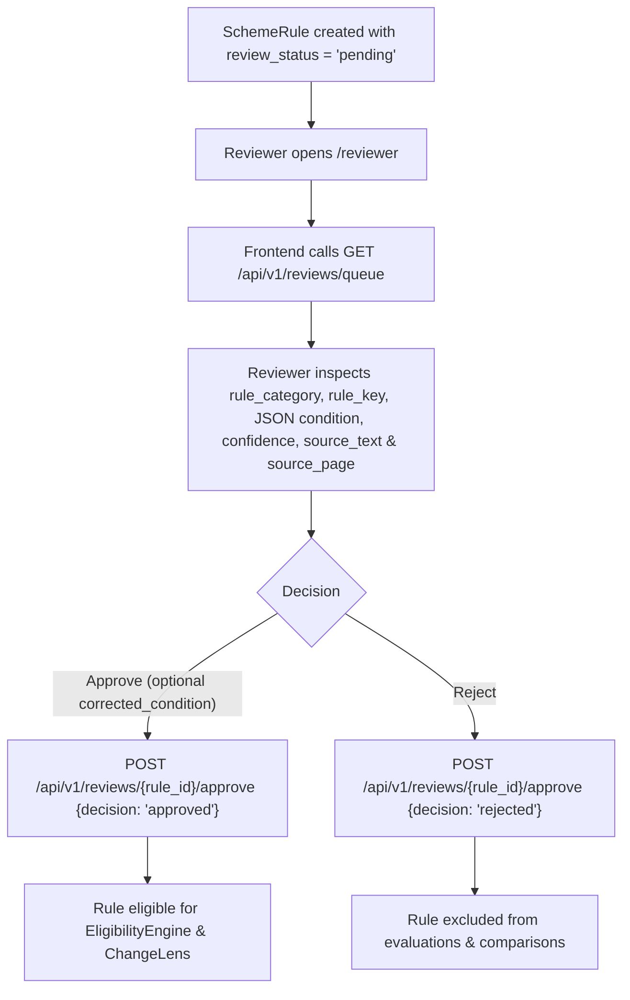

# Document Review Workflow

## Short Explanation

Before any AI-extracted eligibility condition can affect a student's eligibility score or appear in ChangeLens comparisons, a human reviewer inspects the extracted rule side-by-side with the verbatim quote and page number from the official document and explicitly approves or rejects it.

---

## 1. Why This Workflow Exists & What Problem It Solves

LLMs can misread complex tables, footnote exceptions, or regional currency units (e.g., "Rs. 2.50 lakh" vs. `250000`). A **Human-in-the-Loop (HITL)** review gate ensures AI accelerates rule digitization without sacrificing policy accuracy.

---

## 2. Workflow Diagram

---

## 3. Technical Implementation

### Backend (`backend/app/modules/reviews/router.py`)

Both endpoints enforce `require_roles("document_reviewer", "admin", "super_admin")`:

1. **`GET /api/v1/reviews/queue`**:
   - Queries `SchemeRule` where `SchemeRule.review_status == "pending"` (limit 50).
   - Returns `id`, `version_id`, `rule_category`, `rule_key`, `condition`, `source_text`, `source_page`, and `confidence`.
2. **`POST /api/v1/reviews/{rule_id}/approve`**:
   - Accepts `ReviewDecisionRequest(decision: str, note: Optional[str], corrected_condition: Optional[dict])`.
   - Sets `review_status = data.decision`, `reviewed_by = current_user.user_id`, `reviewed_at = utcnow()`, `reviewer_note = data.note`, and optionally overwrites `rule.condition = data.corrected_condition`.

### Frontend (`frontend/src/app/reviewer/page.tsx`)

- Calls `GET /reviews/queue` on mount.
- Renders each pending rule with:
  - Confidence badge (`>= 0.8` → **High confidence** green badge; `< 0.8` → **Low confidence** amber warning badge).
  - Formatted JSON view of `rule.condition`.
  - Highlighted box showing verbatim `source_text` and `source_page`.
  - **Approve** and **Reject** action buttons calling `POST /reviews/{id}/approve`.

---

## 4. Security & Integrity Considerations

- `eligibility/router.py` filters `SchemeRule.review_status == "approved"` AND `SchemeVersion.is_approved == True, SchemeVersion.is_active == True`.
- `changelens/router.py` filters `SchemeRule.review_status == "approved"`.
- Audit columns `reviewed_by`, `reviewed_at`, and `reviewer_note` record accountability on every decision.

---

## 5. Current Implementation Status & Gaps

- **Implemented**: Both API endpoints and the `/reviewer` frontend queue UI are implemented.
- **Gaps**:
  - `ReviewDecisionRequest.decision` is typed as `str` rather than `Literal["approved", "rejected"]`, meaning invalid strings are not rejected by Pydantic validation.
  - The `/reviewer` UI does not yet expose an editor for `corrected_condition` or `note`, even though the backend supports both fields.
  - Approving all rules in a `SchemeVersion` does not yet automatically flip `SchemeVersion.is_approved` / `is_active` or update `Scheme.latest_version_id`.

---

## 6. Related Documentation

- [Human-in-the-Loop](../06-ai-and-intelligence/HUMAN_IN_THE_LOOP.md)
- [Rule Extraction](../06-ai-and-intelligence/RULE_EXTRACTION.md)
- [Admin Workflow](ADMIN_WORKFLOW.md)

