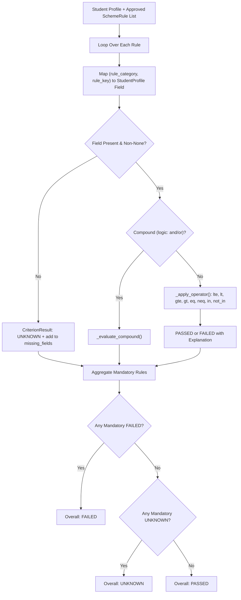

# Eligibility Engine

## Short Explanation

The eligibility engine checks a student's profile against the official, human-approved conditions of a scholarship—such as annual family income, marks percentage, CGPA, age, caste category, disability status, domicile state, and course. Each condition receives a clear result (`passed`, `failed`, or `unknown`) so the student understands *why* they qualify, *why* they do not, or *which missing profile field* needs to be filled in.

---

## 1. Why This Module Exists & What Problem It Solves

Asking a generative AI model whether a student qualifies for a ₹20,000 scholarship is risky because LLMs can confuse `<=` vs `<`, invent thresholds, or guess when data is missing. NiyamDrishti's `EligibilityEngine` uses **deterministic Python arithmetic and set membership** so identical inputs always yield identical, auditable results.

---

## 2. Evaluation Flow Diagram

---

## 3. Technical Implementation

### Core Engine (`backend/app/modules/eligibility/engine.py`)

- **Supported Operators (`OPERATOR_MAP`)**: `lte`, `lt`, `gte`, `gt`, `eq`, `neq`, `in`, `not_in`. (`contains` and `any` are mentioned in the module docstring but are **not implemented** in `OPERATOR_MAP` and return `UNKNOWN`.)
- **Profile Field Mapping (`_get_profile_field`)**:
  - `income` → `annual_family_income`
  - `marks` → `marks_percentage`
  - `cgpa` → `cgpa`
  - `age` → `age_years` (computed in `router.py` from `StudentProfile.date_of_birth`)
  - `category` → `caste_category`
  - `disability` → `is_pwd`
  - `domicile` → `domicile_state` (falls back to `state` in `router.py`)
  - `state` → `state`
  - `course` → `course_name`
  - `education_level` → `education_level`
- **Match Score Formula**:
  $$\text{match\_score} = \text{round}\left(\frac{\text{passed\_mandatory}}{\text{passed\_mandatory} + \text{failed\_mandatory}} \times 100, 1\right)$$
  *(Note: `unknown` mandatory rules are excluded from the denominator, so match score is directional only.)*

### API Endpoint (`backend/app/modules/eligibility/router.py`)

- **`POST /api/v1/eligibility/evaluate`** (authenticated):
  1. Verifies `Scheme` exists and has an active, approved `SchemeVersion` (`is_approved=True, is_active=True`) with `approved` `SchemeRule` rows.
  2. Loads `StudentProfile` (or uses `profile_overrides` directly when `is_simulation=True`).
  3. Calls `eligibility_engine.evaluate(rules_list, profile)`.
  4. Persists `StudentSchemeEvaluation` in PostgreSQL (skipped when `is_simulation=True`).
  5. Returns `EligibilityEvaluateResponse` including mandatory disclaimer.

---

## 4. Known Bug & Contract Mismatches (Verified)

> [!WARNING]
> Two issues were directly observed during repository verification:
> 1. ~~**Compound Rule Bug**~~ — **Fixed**: compound `and`/`or` rules now inherit the parent rule's category/key, and `test_compound_and_all_pass` / `test_compound_or_one_passes` pass (all 15 eligibility tests green).
> 2. **Frontend–Backend Schema Mismatch**: `frontend/src/app/eligibility/page.tsx` reads `report.criteria` and matches uppercase `"PASSED"` / `"FAILED"`, while the backend returns `criterion_results` and lowercase `"passed"` / `"failed"`. Also, on missing profile, backend returns `422` while frontend checks for `404`.

---

## 5. Current Implementation Status

- **Unit Tests**: 13 passed, 2 failed out of 15 in `backend/tests/test_eligibility_engine.py`.
- **Router**: Implemented (not integration-tested).
- **Frontend**: `/eligibility` page and `CriterionResult` component implemented; needs field/case alignment with backend.

---

## 6. Related Documentation

- [Eligibility Algorithm](../06-ai-and-intelligence/ELIGIBILITY_ALGORITHM.md)
- [Test Results](../08-testing-and-quality/TEST_RESULTS.md)
- [Known Limitations](../08-testing-and-quality/KNOWN_LIMITATIONS.md)

