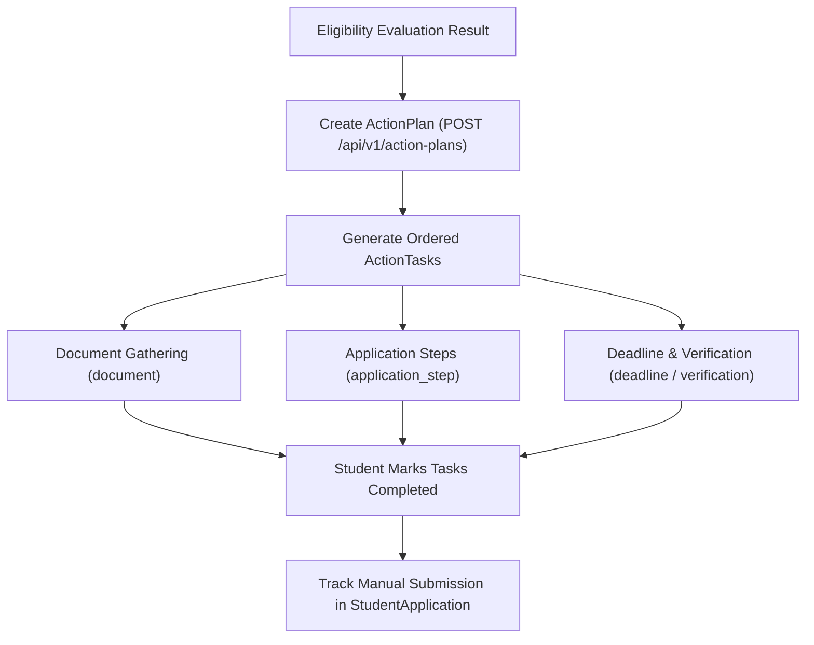

# LifeMap — Personalized Action Planning

## Short Explanation

**LifeMap** turns an eligibility result into a concrete, trackable checklist of steps—gathering required documents, completing forms, and tracking submission deadlines—alongside manual application status tracking.

---

## 1. Why This Module Exists & What Problem It Solves

Discovering you are eligible for a scholarship is only half the journey. Students frequently miss deadlines or omit supporting certificates (income certificate, caste certificate, bonafide letter). LifeMap structures those steps into ordered tasks (`ActionTask`) grouped inside an `ActionPlan`.

---

## 2. Intended End-to-End Flow

---

## 3. Technical Implementation (Actual Codebase)

### Database Models (`backend/app/database/models/application.py`)

1. **`ActionPlan` (`action_plans`)**:
   - `student_id` (FK → `user_profiles.id`), `scheme_id` (FK → `schemes.id`), `evaluation_id` (optional UUID), `status` (`active|completed|abandoned`), `report_storage_path` (for future PDF export).
2. **`ActionTask` (`action_tasks`)**:
   - `plan_id` (FK → `action_plans.id`), `task_type` (`document|application_step|deadline|alternative|verification`), `title`, `description`, `order_index`, `due_date`, `is_completed`, `completed_at`, `task_metadata` (JSONB).
3. **Related Model — `StudentApplication` (`student_applications`) & `ApplicationStatusHistory`**:
   - Tracks manual user-reported statuses (`planning`, `documents_gathering`, `submitted`, `under_review`, `approved`, `rejected`, `withdrawn`) with an audit trail. Explicitly documented in code: *"NiyamDrishti does NOT auto-submit to government portals."*

### Backend Endpoints

- `backend/app/modules/lifemap/router.py`:
  - `GET /api/v1/action-plans/me`: Lists active `ActionPlan` records (`id`, `scheme_id`, `status`) for the current user.
  - `POST /api/v1/action-plans`: Creates an `ActionPlan` and inserts **3 static default tasks**:
    1. `"Gather required documents"` (`document`)
    2. `"Complete online application form"` (`application_step`)
    3. `"Submit application before deadline"` (`verification`)
- `backend/app/modules/applications/router.py`:
  - `GET /api/v1/applications/me`, `POST /api/v1/applications`, `PATCH /api/v1/applications/{application_id}` (records `ApplicationStatusHistory`).

### Frontend (`frontend/src/app/lifemap/page.tsx`)

- Renders collapsible action-plan cards with progress bars (`done/total tasks · %`) and task completion buttons.

---

## 4. Current Implementation Status & Gaps

> [!WARNING]
> **LifeMap is partially implemented** with several gaps between the UI, models, and backend router:
> 1. **Endpoint Path Mismatch**: `frontend/src/app/lifemap/page.tsx` calls `GET /lifemap/plans` and `PATCH /lifemap/tasks/{taskId}`, whereas backend exposes `GET /api/v1/action-plans/me` and `POST /api/v1/action-plans` (no `PATCH` task endpoint exists yet).
> 2. **Response Shape Gap**: `GET /api/v1/action-plans/me` currently returns `id`, `scheme_id`, and `status` without eager-loading `tasks` or `scheme_name`.
> 3. **Static Task Generation**: `POST /api/v1/action-plans` inserts 3 generic tasks rather than dynamically deriving document tasks from `SchemeRule(rule_category="document")` or alternative schemes when ineligible.
> 4. **PDF Report Export**: `ActionPlan.report_storage_path` exists in the DB schema, but PDF generation is not implemented.

---

## 5. Related Documentation

- [Student Journey](STUDENT_JOURNEY.md)
- [Database Schema](../05-database-and-api/DATABASE_SCHEMA.md)
- [API Reference](../05-database-and-api/API_REFERENCE.md)

