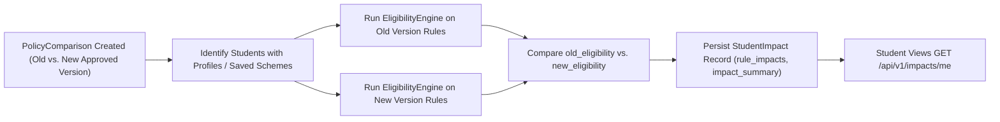

# Personalized Impact Engine

## Short Explanation

The Personalized Impact Engine connects **ChangeLens** (what changed in a scheme's rules) with the **Eligibility Engine** (what applies to an individual student) to answer: *"Because this policy changed, did I become newly eligible, newly ineligible, or remain unaffected?"*

---

## 1. Why This Module Exists & What Problem It Solves

Knowing that an income cap changed or a marks requirement increased is helpful, but students want to know whether *their* application status changed. Computing `old_eligibility` vs. `new_eligibility` per student prevents missed deadlines and wasted effort.

---

## 2. Conceptual & Planned Impact Flow

---

## 3. What Is Actually Implemented in the Codebase

### Database Model (`backend/app/database/models/application.py`)

`StudentImpact` (`student_impacts` table) is **fully defined**:

- `student_id` (FK → `user_profiles.id`)
- `comparison_id` (FK → `policy_comparisons.id`)
- `scheme_id` (FK → `schemes.id`)
- `old_eligibility` (`String(20)`)
- `new_eligibility` (`String(20)`)
- `eligibility_changed` (`Boolean`)
- `impact_summary` (`Text`)
- `rule_impacts` (`JSONB`)
- `is_notified` (`Boolean`)

### Backend API (`backend/app/modules/impact/router.py`)

- **`GET /api/v1/impacts/me`** (authenticated): Queries `StudentImpact` for the current user, ordered by `created_at DESC` (limit 20), and returns `id`, `scheme_id`, `old_eligibility`, `new_eligibility`, `eligibility_changed`, `impact_summary`, `created_at`.

### What Is NOT Yet Implemented

> [!NOTE]
> The Personalized Impact Engine is **partially implemented**:
> - There is **no service or background job** that populates `student_impacts` rows when a `PolicyComparison` is created.
> - There is **no frontend page** specifically displaying `/impacts/me` (though the landing page highlights "Personalised Impact Engine" as a core capability).
> - Simulation mode (`is_simulation=True` on `POST /api/v1/eligibility/evaluate`) works for ad-hoc single-version what-if testing, not cross-version impact diffs.

---

## 4. Future Improvements

1. Add an impact calculation service triggered upon `POST /api/v1/policy-comparisons` (or via background job) to evaluate affected `StudentProfile` records against both versions and insert `StudentImpact` rows.
2. Add a dedicated Impact Alerts section on `/dashboard` and `/changelens` showing personal eligibility shifts.
3. Wire `is_notified` to the notifications module once implemented.

---

## 5. Related Documentation

- [Impact Analysis](../06-ai-and-intelligence/IMPACT_ANALYSIS.md)
- [ChangeLens](CHANGELENS.md)
- [Eligibility Engine](ELIGIBILITY_ENGINE.md)
- [Project Audit](../PROJECT_AUDIT.md)

