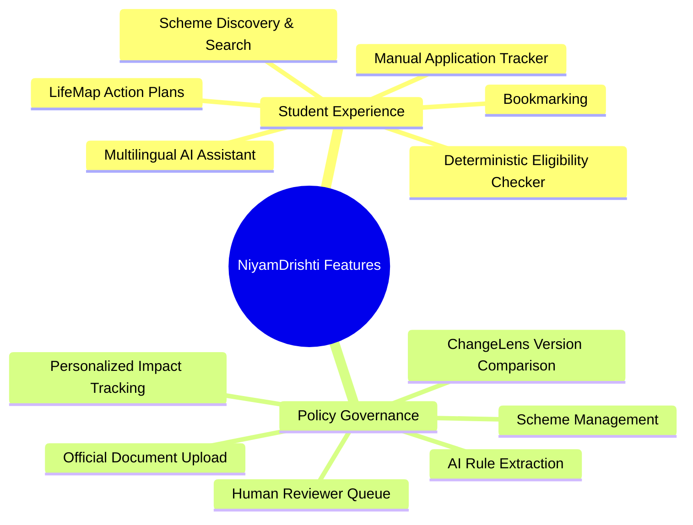

# Product Features

## Short Explanation

NiyamDrishti organizes its capabilities into student-facing opportunity tools and staff-facing policy governance workflows, backed by a deterministic evaluation core.

---

## 1. Feature Map

---

## 2. Feature Matrix & Actual Implementation Status

| Feature | Primary User | Key Frontend Route | Key Backend Endpoint(s) | Current Status |
|---|---|---|---|---|
| **Authentication & Onboarding** | All Roles | `/login`, `/register`, `/auth/callback` | `GET /api/v1/auth/status` | **Implemented** (Supabase Auth Email + Google OAuth; Phone OTP planned) |
| **Student Profile** | Student | `/settings/profile` | `GET/PATCH /api/v1/profiles/me`, `POST /api/v1/profiles` | **Implemented** |
| **Scheme Discovery** | Public / Student | `/schemes`, `/schemes/[id]` | `GET /api/v1/schemes`, `GET /api/v1/schemes/{id}` | **Implemented** (`max_income`/`min_marks` query params not yet filtered in `SchemeService`) |
| **Scheme Bookmarking** | Student | `/schemes/[id]` | `POST /api/v1/schemes/{id}/bookmark` | **Implemented** |
| **Eligibility Engine** | Student | `/eligibility` | `POST /api/v1/eligibility/evaluate` | **Implemented with issues** (2 compound-rule unit tests fail; frontend reads `report.criteria` vs `criterion_results`) |
| **ChangeLens** | Student / Reviewer / Admin | `/changelens` | `POST /api/v1/policy-comparisons`, `GET /api/v1/policy-comparisons/{id}` | **Implemented** (14/14 engine tests pass; frontend calls non-existent `GET /changelens/compare/{id}`) |
| **Personalized Impact Engine** | Student | Landing page mention | `GET /api/v1/impacts/me` | **Partially Implemented** (`StudentImpact` table & GET route exist; computation service not implemented) |
| **LifeMap** | Student | `/lifemap` | `GET /api/v1/action-plans/me`, `POST /api/v1/action-plans` | **Partially Implemented** (backend creates 3 default tasks; frontend calls `/lifemap/plans` & `/lifemap/tasks/{id}`) |
| **Application Tracker** | Student | `/applications` | `GET /api/v1/applications/me`, `POST /api/v1/applications`, `PATCH /api/v1/applications/{id}` | **Implemented** (frontend calls `/applications` & uses mismatched status labels) |
| **AI Assistant** | Student | `/assistant` | `POST /api/v1/assistant/chat` | **Partially Implemented** (direct OpenAI chat EN/TE/HI; no vector RAG yet; payload mismatch with UI) |
| **Document Upload & OCR** | Admin | `/admin` (subpage `/admin/documents` missing) | `POST /api/v1/documents/upload`, `GET /api/v1/documents/{id}/status` | **Partially Implemented** (magic bytes & job insert work; Storage upload & worker execution not wired) |
| **Reviewer Queue** | Document Reviewer / Admin | `/reviewer` | `GET /api/v1/reviews/queue`, `POST /api/v1/reviews/{id}/approve` | **Implemented** |
| **Notifications** | Student | `/notifications` (page missing) | `GET /api/v1/notifications/me` | **Stubbed** (returns empty list) |
| **Monitoring & Jobs** | Admin | `/admin` | `GET /api/v1/admin/system-health`, `GET /api/v1/admin/jobs` | **Partially Implemented** (`jobs` is a stub; `system-health` returns static status) |

---

## 3. Related Documentation

- [Student Journey](STUDENT_JOURNEY.md)
- [Admin Workflow](ADMIN_WORKFLOW.md)
- [Document Review Workflow](DOCUMENT_REVIEW_WORKFLOW.md)
- [Project Audit](../PROJECT_AUDIT.md)

