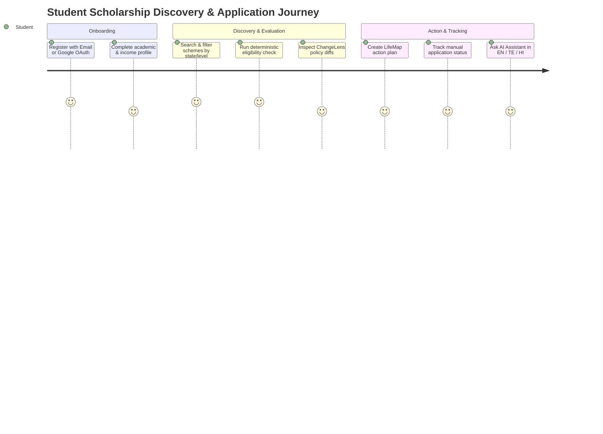

# Student Journey

## Short Explanation

The student journey guides a learner from creating a free account and completing their academic/income profile to discovering matching schemes, checking deterministic eligibility, reviewing policy updates, and tracking manual applications.

---

## 1. Why This Journey Exists & What Problem It Solves

Students often abandon scholarship applications mid-way because portals scatter eligibility rules, required documents, and deadlines across separate PDFs. NiyamDrishti connects profile input, scheme discovery, eligibility explanation, and checklist tracking into a single linear flow.

---

## 2. Journey Diagram

---

## 3. Step-by-Step Workflow

1. **Account Creation (`/register` or `/login`)**:
   - The student signs up via Supabase Auth (`supabase.auth.signUp`) with `full_name` and `app_role: "student"` in `user_metadata`, or signs in via Google OAuth (`/auth/callback`).
2. **Dashboard Landing (`/dashboard`)**:
   - Displays quick-action cards (`Discover Schemes`, `ChangeLens`, `My Eligibility`, `LifeMap`), profile completion prompt, and notification summary.
3. **Profile Setup (`/settings/profile`)**:
   - Student enters Education (`education_level`, `course_name`, `college_name`, `current_year_semester`, `marks_percentage`, `cgpa`), Location (`state`, `district`), Economic (`annual_family_income`), and optional Category (`caste_category`, `is_pwd`).
   - Saved via `POST /api/v1/profiles` or `PATCH /api/v1/profiles/me`.
4. **Scheme Discovery (`/schemes` & `/schemes/[id]`)**:
   - Publicly accessible discovery page (`GET /api/v1/schemes`) with search (`q`), `state`, and `education_level` filters.
   - Scheme detail page displays amount, deadline, department, eligible categories, official links, bookmark toggle (`POST /api/v1/schemes/{id}/bookmark`), and a direct **Check My Eligibility** link (`/eligibility?scheme_id=...`).
5. **Eligibility Check (`/eligibility`)**:
   - Calls `POST /api/v1/eligibility/evaluate` and displays overall result, match score, and per-criterion breakdown via `CriterionResult`.
6. **Policy Diffs (`/changelens`) & Impact (`/api/v1/impacts/me`)**:
   - Allows inspecting rule changes across scheme versions.
7. **LifeMap (`/lifemap`) & Application Tracking (`/applications`)**:
   - Generates a 3-step `ActionPlan` (`POST /api/v1/action-plans`) and tracks manual submission milestones (`StudentApplication`: `planning` → `documents_gathering` → `submitted` → `under_review` → `approved`/`rejected`/`withdrawn`).
8. **AI Assistant (`/assistant`)**:
   - Enables natural-language questions about schemes in English, Telugu, or Hindi.

---

## 4. Technical Implementation & Current Gaps

- **Route Protection**: `frontend/src/middleware.ts` protects `/dashboard`, `/schemes`, `/eligibility`, `/changelens`, `/lifemap`, `/applications`, `/assistant`, `/notifications`, and `/settings`, redirecting unauthenticated visitors to `/login`. *(Note: backend `GET /api/v1/schemes` is public, while Next.js middleware currently includes `/schemes` in `PROTECTED_PATHS`.)*
- **Current Integration Gaps**:
  - `dashboard/page.tsx` renders static `0%` profile completeness and placeholder cards rather than fetching live `/profiles/me` or `/notifications/me` counts.
  - Contract mismatches exist on `/eligibility`, `/changelens`, `/lifemap`, `/applications`, and `/assistant` pages (detailed in each module doc and [Project Audit](../PROJECT_AUDIT.md)).

---

## 5. Related Documentation

- [Eligibility Engine](ELIGIBILITY_ENGINE.md)
- [ChangeLens](CHANGELENS.md)
- [LifeMap](LIFEMAP.md)
- [AI Assistant](AI_ASSISTANT.md)
- [Authentication](../04-technical/AUTHENTICATION.md)

