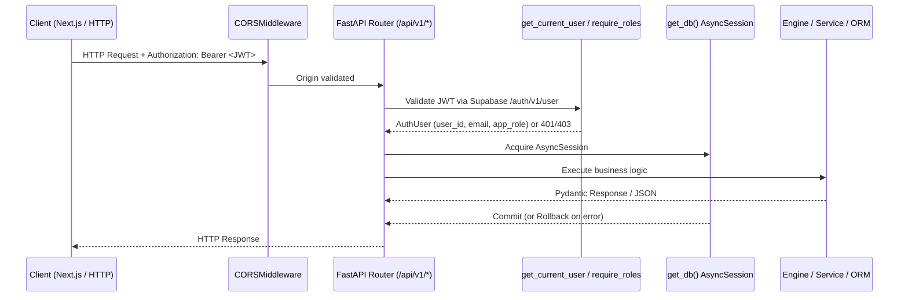

# API Architecture

## Short Explanation

The NiyamDrishti backend exposes a RESTful JSON API under `/api/v1` using FastAPI routers, Pydantic v2 request/response schemas, Bearer JWT authentication, and role-based dependencies.

---

## 1. Why This Architecture Exists & What Problem It Solves

Using FastAPI with Pydantic v2 gives automatic request validation (`422` on malformed input), OpenAPI schema generation in development, and clean dependency injection for database sessions (`get_db`), authentication (`get_current_user`, `get_optional_user`), and authorization (`require_roles`).

---

## 2. Request Lifecycle Diagram

---

## 3. Technical Conventions

- **API Prefix**: All 14 domain routers are mounted at `API_PREFIX = "/api/v1"` in `backend/app/main.py`.
- **Health & Root**: `GET /` and `GET /health` live outside `/api/v1`.
- **OpenAPI Docs**: Served at `/api/docs`, `/api/redoc`, and `/api/openapi.json` when `APP_ENV != "production"`.
- **Authentication Pattern**:
  - Public endpoints (`GET /schemes`, `GET /schemes/{id}`) use `get_optional_user`.
  - Authenticated user endpoints use `get_current_user`.
  - Privileged endpoints use `require_roles(...)` (`RoleChecker`).
- **Typed Schemas vs. Dict Returns**:
  - `schemes`, `eligibility`, `changelens`, and `assistant` routers define explicit `response_model` Pydantic classes.
  - `users`, `profiles`, `documents`, `reviews`, `impact`, `lifemap`, `applications`, `notifications`, and `monitoring` return inline dicts or ORM objects directly.

---

## 4. Known API & Contract Observations

- **Frontend Proxy**: `frontend/vercel.json` rewrites `/api/:path*` to `https://niyamdrishti-api.onrender.com/api/:path*`, while `frontend/src/lib/api-client.ts` targets `${NEXT_PUBLIC_API_URL}/api/v1`.
- **Frontend–Backend Mismatches**: Five student pages (`eligibility`, `changelens`, `lifemap`, `applications`, `assistant`) have route path or JSON field mismatches against the backend routers (catalogued in [Project Audit](../PROJECT_AUDIT.md) and [API Reference](../05-database-and-api/API_REFERENCE.md)).

---

## 5. Related Documentation

- [API Reference](../05-database-and-api/API_REFERENCE.md)
- [API Response Format](../05-database-and-api/API_RESPONSE_FORMAT.md)
- [Error Handling](../04-technical/ERROR_HANDLING.md)

