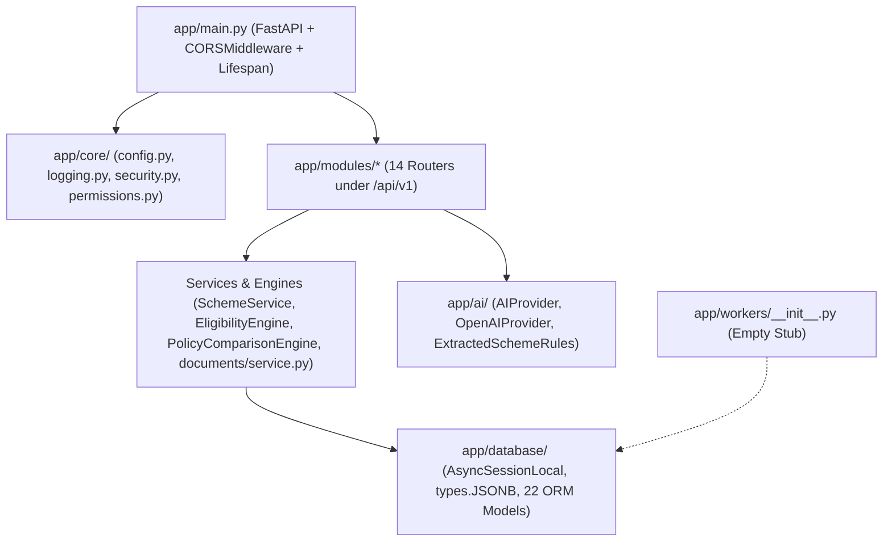

# Backend Architecture

## Short Explanation

The NiyamDrishti backend is an asynchronous **FastAPI** application structured as a modular monolith with 14 domain packages, Pydantic v2 settings/validation, structured logging (`structlog`), and SQLAlchemy 2.0 async persistence.

---

## 1. Why This Architecture Exists & What Problem It Solves

A modular monolith keeps deployment simple (one Docker image / Render web service) while cleanly isolating domain boundaries (`schemes`, `eligibility`, `changelens`, `documents`, `reviews`, `assistant`, etc.) so pure-Python engines can be unit-tested without HTTP or database dependencies.

---

## 2. Backend Module Architecture

---

## 3. Technical Implementation

### Application Entry Point (`backend/app/main.py`)

- **Lifespan hook**: Logs `app_env`, `debug`, and `ai_available` on startup and shutdown.
- **Middleware**: `CORSMiddleware` configured from `settings.cors_origins_list`, allowing `GET`, `POST`, `PUT`, `PATCH`, `DELETE`, `OPTIONS` and headers `Authorization`, `Content-Type`, `X-Request-ID`.
- **OpenAPI Visibility**: `/api/docs`, `/api/redoc`, and `/api/openapi.json` are enabled in non-production environments and disabled (`None`) when `APP_ENV=production`.
- **Root Routes**: `GET /` and `GET /health`.

### Core Infrastructure (`backend/app/core/`)

| File | Responsibility |
|---|---|
| `config.py` | `Settings(BaseSettings)` loaded from `.env`; validates `secret_key >= 32` chars; exposes `cors_origins_list`, `is_production`, `ai_available`. |
| `logging.py` | Configures `structlog` (`console` or `json` format) and suppresses verbose `httpx`/`httpcore`/`supabase` logs to `WARNING`. |
| `permissions.py` | `AppRole` enum (`student`, `college_coordinator`, `document_reviewer`, `admin`, `super_admin`) and role sets (`ADMIN_ROLES`, `REVIEWER_ROLES`, etc.). |
| `security.py` | `verify_supabase_token` via `GET {SUPABASE_URL}/auth/v1/user`, `get_current_user`, `get_optional_user`, `RoleChecker`, `require_roles`, `require_self_or_roles`. |

### Domain Modules (`backend/app/modules/`)

1. `auth` — Auth status endpoint (`GET /auth/status`).
2. `users` — Current user profile lookup (`GET /users/me`).
3. `profiles` — Student profile CRUD (`GET/POST/PATCH`).
4. `schemes` — Public discovery, bookmarking, admin CRUD & publishing (`router.py`, `schemas.py`, `service.py`).
5. `eligibility` — Deterministic `EligibilityEngine` + evaluation/simulation endpoint.
6. `documents` — Upload validation, magic bytes, SHA-256, PyMuPDF/OCR/DOCX text extraction (`service.py`, `router.py`).
7. `changelens` — Deterministic `PolicyComparisonEngine` + comparison persistence/retrieval.
8. `impact` — `GET /impacts/me` reader for `StudentImpact`.
9. `lifemap` — `ActionPlan` & default `ActionTask` creation/listing.
10. `applications` — Manual `StudentApplication` CRUD + `ApplicationStatusHistory` audit log.
11. `assistant` — Multilingual OpenAI chat endpoint with system prompt guardrails.
12. `reviews` — Pending `SchemeRule` review queue and approval/rejection endpoint.
13. `notifications` — Stub endpoint (`GET /notifications/me`).
14. `monitoring` — Admin health check and stubbed job list (`GET /admin/system-health`, `GET /admin/jobs`).

---

## 4. Current Implementation Status & Gaps

- **Production-ready patterns**: Async SQLAlchemy session lifecycle with automatic commit/rollback in `get_db()`, Pydantic v2 request/response validation, and clean pure-Python engines.
- **Gaps**: `app/workers/__init__.py` is empty; `notifications` and `admin/jobs` are stubs; `monitoring/system-health` does not query PostgreSQL/Storage dynamically; leftover `backend/_fix_router.py` helper script sits in `backend/`.

---

## 5. Related Documentation

- [System Architecture](SYSTEM_ARCHITECTURE.md)
- [API Architecture](API_ARCHITECTURE.md)
- [Database Architecture](DATABASE_ARCHITECTURE.md)
- [Backend Setup](../07-development/BACKEND_SETUP.md)

