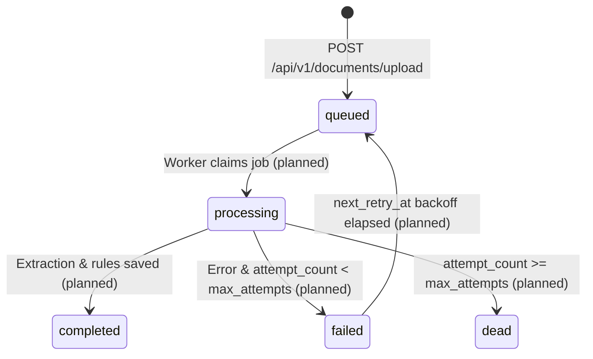

# Background Jobs Architecture

## Short Explanation

NiyamDrishti is designed around a lightweight **PostgreSQL-backed job queue** (`document_processing_jobs` and `document_processing_attempts` tables) so heavy PDF text extraction, OCR, and LLM rule extraction can run asynchronously without blocking API responses.

---

## 1. Why This Architecture Exists & What Problem It Solves

Running 300-DPI Tesseract OCR and LLM structured extraction on a 50-page PDF inside a synchronous HTTP request would cause client timeouts and block Uvicorn workers. Persisting jobs in PostgreSQL provides durability, idempotency, retry tracking, and progress visibility without requiring an external broker in minimal deployments.

---

## 2. Job Lifecycle State Machine (Designed Schema)

---

## 3. Technical Implementation (Actual Codebase)

### Database Models (`backend/app/database/models/document.py`)

1. **`DocumentProcessingJob` (`document_processing_jobs`)**:
   - `document_id`, `document_type` (`scheme_document|student_upload`), `job_type` (`extract_text|ocr|extract_rules|compare_versions`)
   - `idempotency_key` (unique string, e.g., `extract_{sha256}`)
   - `status` (`queued|processing|completed|failed|dead`), `priority` (default `5`), `progress_pct` (`0–100`)
   - Timing & retries: `scheduled_at`, `started_at`, `completed_at`, `next_retry_at`, `attempt_count`, `max_attempts` (default `3`)
   - Outputs: `result` (`JSONB`), `error_message` (`Text`), `job_metadata` (`JSONB`)
2. **`DocumentProcessingAttempt` (`document_processing_attempts`)**:
   - Audit log per attempt: `job_id` (FK), `attempt_number`, `started_at`, `completed_at`, `status`, `error_message`, `worker_id`.

### Configuration (`backend/app/core/config.py`)

- `worker_poll_interval`: `5` seconds
- `worker_max_retries`: `3`
- `worker_retry_backoff_seconds`: `60` seconds

### Redis Status

- `docker-compose.yml` provisions an optional `redis:7-alpine` container (`6379`), **but no Python Redis package or Redis worker code exists in `backend/`**.

---

## 4. Current Implementation Status & Gaps

> [!IMPORTANT]
> **The job queue schema is implemented, but the worker itself is NOT implemented yet.**
> - `backend/app/workers/__init__.py` is an empty file (`0` bytes).
> - `POST /api/v1/documents/upload` successfully inserts a `DocumentProcessingJob` with `status="queued"`.
> - `GET /api/v1/admin/jobs` in `monitoring/router.py` is a stub returning `{"jobs": [], "message": "Job listing requires database query — implement in Phase 9"}`.

---

## 5. Related Documentation

- [Document Processing](DOCUMENT_PROCESSING.md)
- [Database Schema](../05-database-and-api/DATABASE_SCHEMA.md)
- [Known Limitations](../08-testing-and-quality/KNOWN_LIMITATIONS.md)

