# Database Architecture

## Short Explanation

NiyamDrishti stores all users, student profiles, versioned scholarship rules, uploaded document metadata, processing jobs, eligibility evaluations, policy comparisons, action plans, and application history in **PostgreSQL 16** accessed asynchronously via **SQLAlchemy 2.0** and `asyncpg`.

---

## 1. Why This Architecture Exists & What Problem It Solves

Scholarship eligibility rules vary widely across schemes (income caps, category lists, CGPA thresholds, compound conditions). Storing structured conditions in **JSONB** (`SchemeRule.condition`) attached to immutable `SchemeVersion` snapshots gives relational integrity for schemes and users while keeping rule conditions flexible and queryable.

---

## 2. Logical Domain Architecture

```mermaid
flowchart LR
    subgraph Identity["Identity & Institutions"]
        UP["user_profiles"]
        SP["student_profiles"]
        COL["colleges"]
        CM["college_memberships"]
        AI["admin_invitations"]
    end

    subgraph Policy["Schemes & ChangeLens"]
        SC["schemes"]
        SS["scheme_sources"]
        SD["scheme_documents"]
        SV["scheme_versions"]
        SR["scheme_rules"]
        PC["policy_comparisons"]
        PCE["policy_change_events"]
    end

    subgraph Jobs["Uploads & Queue"]
        DU["document_uploads"]
        DPJ["document_processing_jobs"]
        DPA["document_processing_attempts"]
    end

    subgraph StudentOps["Student Outcomes"]
        SSE["student_scheme_evaluations"]
        SAV["saved_schemes"]
        SI["student_impacts"]
        AP["action_plans"]
        AT["action_tasks"]
        SA["student_applications"]
        ASH["application_status_history"]
    end

    Identity --> StudentOps
    Policy --> StudentOps
    Jobs -.->|document_id| Policy
```

---

## 3. Technical Implementation

### Async Engine & Pooling (`backend/app/database/database.py`)

- Uses `create_async_engine(settings.database_url)` with `AsyncSessionLocal` (`expire_on_commit=False`, `autocommit=False`, `autoflush=False`).
- When not using SQLite (`not settings.database_url.startswith("sqlite")`), configures `pool_size=10`, `max_overflow=20`, and `pool_pre_ping=True`.
- `get_db()` yields an `AsyncSession`, commits on success, rolls back on exception, and closes in `finally`.

### Cross-Dialect `JSONB` Type (`backend/app/database/types.py`)

- Custom `JSONB(TypeDecorator)` resolves to `sqlalchemy.dialects.postgresql.JSONB` on PostgreSQL and `sqlalchemy.JSON` on SQLite—allowing all 22 models to run unmodified in the `sqlite+aiosqlite:///:memory:` `pytest` fixture.

### Base Mixins (`backend/app/database/models/base.py`)

- `UUIDMixin`: UUID primary key (`default=uuid.uuid4`).
- `TimestampMixin`: `created_at` and `updated_at` (`DateTime(timezone=True)`, `server_default=func.now()`).
- `SoftDeleteMixin`: `deleted_at` (`DateTime(timezone=True)`, nullable) + `is_deleted` property (used on `Scheme`).

---

## 4. Current Implementation Status & Gaps

- **22 ORM Models**: Fully defined across `user.py`, `scheme.py`, `document.py`, and `application.py`, and exported via `models/__init__.py`.
- **Alembic Migrations Gap**: `backend/app/database/migrations/versions/` contains no migration scripts yet, and `migrations/env.py` has outdated imports (`User`, `Application`, `Document`).
- **RLS Policies**: Row Level Security policies are not yet committed as SQL migrations in the repository.

---

## 5. Related Documentation

- [Database Schema](../05-database-and-api/DATABASE_SCHEMA.md)
- [Entity Relationship](../05-database-and-api/ENTITY_RELATIONSHIP.md)
- [Database Migrations](../05-database-and-api/DATABASE_MIGRATIONS.md)
- [Database Setup](../07-development/DATABASE_SETUP.md)

