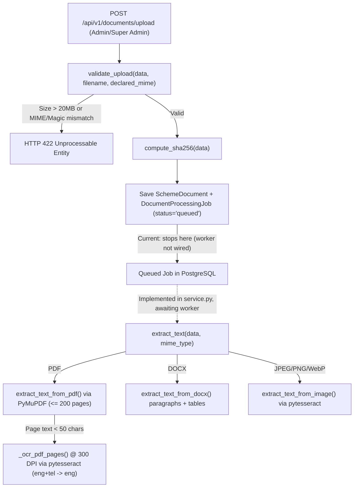

# Document Processing Architecture

## Short Explanation

The document processing module validates uploaded government notification files (size, MIME type, and binary magic bytes), deduplicates them via SHA-256 hashing, extracts text from native PDFs, DOCX files, and images, and falls back to Tesseract OCR for scanned PDF pages.

---

## 1. Why This Module Exists & What Problem It Solves

Official government notifications frequently arrive as scanned PDFs or image attachments rather than clean digital text, and unvalidated uploads pose security risks (spoofed extensions, oversized files, duplicate processing). `app/modules/documents/` standardizes validation and multi-format extraction.

---

## 2. Processing Pipeline Diagram

---

## 3. Technical Implementation

### Upload Validation (`backend/app/modules/documents/service.py`)

- **Allowed MIME types (`ALLOWED_MIME_TYPES`)**:
  - `application/pdf` (magic: `b"%PDF"`)
  - `application/vnd.openxmlformats-officedocument.wordprocessingml.document` (magic: `b"PK\x03\x04"`)
  - `image/jpeg` (magic: `b"\xff\xd8\xff"`)
  - `image/png` (magic: `b"\x89PNG"`)
  - `image/webp` (magic: `b"RIFF"`)
- **Limits (`config.py`)**:
  - `max_upload_size_bytes`: `20 * 1024 * 1024` (20 MB)
  - `max_pdf_pages`: `200` pages
- **Deduplication**: `compute_sha256()` feeds `DocumentProcessingJob.idempotency_key = f"extract_{sha256}"`.

### Text & OCR Extraction (`service.py`)

- **PDF (`extract_text_from_pdf`)**: Uses `fitz` (`PyMuPDF`). Any page with fewer than 50 stripped characters is flagged for OCR (`_ocr_pdf_pages`), rendered at 300 DPI (`fitz.Matrix(300 / 72, 300 / 72)`), and passed to `pytesseract.image_to_string` trying `lang="eng+tel"` with fallback to `lang="eng"`.
- **DOCX (`extract_text_from_docx`)**: Extracts non-empty paragraphs and table cell text using `python-docx`.
- **Images (`extract_text_from_image`)**: Runs `pytesseract` directly via `Pillow`.

### Upload & Status Endpoints (`backend/app/modules/documents/router.py`)

- `POST /api/v1/documents/upload` (`admin`, `super_admin`): Validates upload, creates `SchemeDocument` and `DocumentProcessingJob`, returns `{"document_id", "job_id", "status": "queued"}`.
- `GET /api/v1/documents/{document_id}/status` (authenticated): Queries `DocumentProcessingJob` for `status`, `progress_pct`, `attempt_count`, and `error_message`.

---

## 4. Current Implementation Status & Gaps

> [!WARNING]
> - `documents/router.py` constructs `storage_path = f"official-documents/{scheme_id}/{sha256[:8]}-{file.filename}"`, **but does not upload the raw file bytes to Supabase Storage**.
> - `extract_text` is imported in `documents/router.py` but never invoked, and `app/workers/__init__.py` is empty, so jobs remain `"queued"`.
> - `_ocr_pdf_pages` appends OCR page text to the end of `pages_text` rather than preserving exact page order when mixed with native-text pages.
> - `Dockerfile` installs `tesseract-ocr-eng` only; Telugu (`tesseract-ocr-tel`) and Hindi (`tesseract-ocr-hin`) language packs must be added for regional OCR.

---

## 5. Related Documentation

- [Background Jobs](BACKGROUND_JOBS.md)
- [AI Architecture](AI_ARCHITECTURE.md)
- [Rule Extraction](../06-ai-and-intelligence/RULE_EXTRACTION.md)

