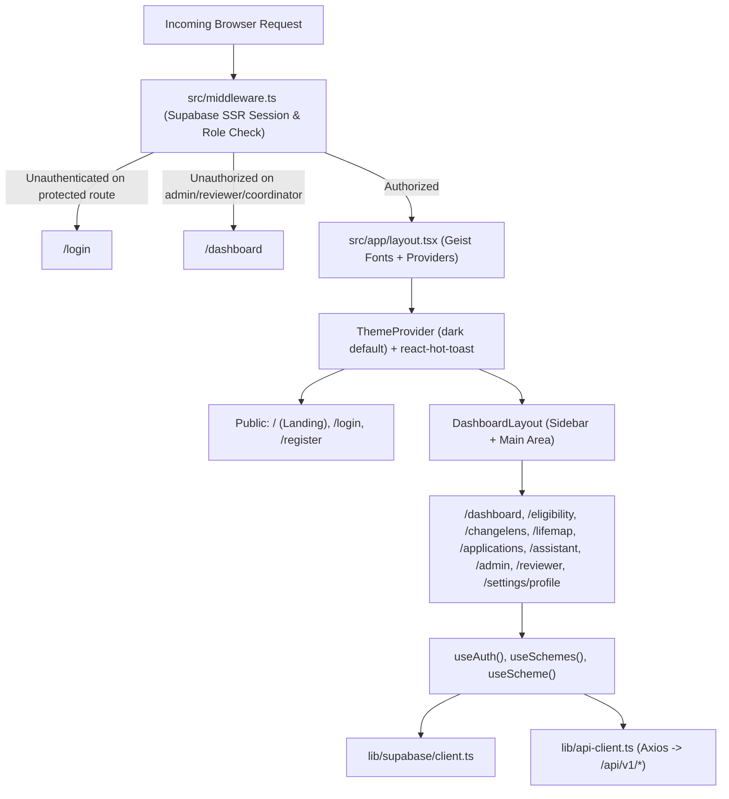

# Frontend Architecture

## Short Explanation

The NiyamDrishti frontend is a **Next.js 16 App Router** application built with **React 19**, **TypeScript**, and **Tailwind CSS v4**, using `@supabase/ssr` for session management and `axios` for backend API requests.

---

## 1. Why This Architecture Exists & What Problem It Solves

Students and reviewers need fast, mobile-responsive interfaces with dark/light theme support, clear loading skeletons, and strict route protection for privileged views (`/admin`, `/reviewer`, `/coordinator`). Next.js App Router provides server-side middleware protection combined with interactive client pages.

---

## 2. Frontend Component & Routing Architecture

---

## 3. Technical Implementation

### Key Configuration (`frontend/next.config.ts`, `frontend/package.json`)

- **Next.js `16.4.6`** with `cacheComponents: true`, `partialPrefetching: true`, and Turbopack CSS rules using `@tailwindcss/turbopack` (`4.3.3`).
- **Styling (`src/app/globals.css`)**: Tailwind v4 `@import "tailwindcss"`, `@theme inline` tokens (`--color-brand-blue: #2563eb`, `--color-brand-cyan: #06b6d4`), `.gradient-primary` utility, and `.skeleton` shimmer animation.
- **UI Primitives (`src/components/ui/`)**: `badge.tsx`, `button.tsx`, `card.tsx`, `input.tsx`, `skeleton.tsx`.
- **Feature Components (`src/components/features/`)**:
  - `schemes/scheme-card.tsx` (`SchemeCard`)
  - `eligibility/criterion-result.tsx` (`CriterionResult`)
  - `changelens/change-event-card.tsx` (`ChangeEventCard`)
- **Layout (`src/components/layout/`)**: `navbar.tsx` (`Navbar`), `sidebar.tsx` (`Sidebar` filtering links by `appRole`).

### Implemented Routes (`frontend/src/app/`)

| Route | File | Rendering | Notes |
|---|---|---|---|
| `/` | `page.tsx` | Client | Marketing hero, stats, 6 feature cards, footer |
| `/login`, `/register` | `(auth)/login/page.tsx`, `(auth)/register/page.tsx` | Client | Email/password + Google OAuth |
| `/auth/callback` | `auth/callback/route.ts` | Route Handler | Exchanges OAuth `code` for Supabase SSR session |
| `/dashboard` | `dashboard/page.tsx` | Client | Quick actions, static profile/notification placeholders |
| `/schemes`, `/schemes/[id]` | `schemes/page.tsx`, `schemes/[id]/page.tsx` | Client / Server wrapper | Search/filter & scheme detail with bookmarking |
| `/eligibility` | `eligibility/page.tsx` | Client | Scheme selector + criterion breakdown |
| `/changelens` | `changelens/page.tsx` | Client | Version comparison view |
| `/lifemap` | `lifemap/page.tsx` | Client | Action plans & task completion |
| `/applications` | `applications/page.tsx` | Client | Application status tracker |
| `/assistant` | `assistant/page.tsx` | Client | Conversational AI chat |
| `/admin` | `admin/page.tsx` | Client | Health card + links to missing subpages |
| `/reviewer` | `reviewer/page.tsx` | Client | Pending rule approval/rejection queue |
| `/settings/profile` | `settings/profile/page.tsx` | Client | Student profile form |

---

## 4. Error Handling, Security & Current Gaps

- `apiClient` (`src/lib/api-client.ts`) reads `nd_access_token` from `localStorage`, injects `Authorization: Bearer ...`, and clears the token + redirects to `/login` on HTTP `401`.
- **Missing Routes Linked in UI**: `/about`, `/privacy`, `/terms`, `/forgot-password`, `/coordinator`, `/notifications`, `/settings`, `/admin/schemes`, `/admin/documents`, `/admin/jobs`, `/admin/users`.
- **TypeScript vs. ESLint**: `npx tsc --noEmit` passes (0 errors), while `npm run lint` fails with 27 problems (9 errors, 18 warnings).
- **Middleware Note**: `middleware.ts` lists `/schemes` in `PROTECTED_PATHS`, preventing unauthenticated browsing of `/schemes` even though the backend `GET /api/v1/schemes` is public.

---

## 5. Related Documentation

- [System Architecture](SYSTEM_ARCHITECTURE.md)
- [Backend Architecture](BACKEND_ARCHITECTURE.md)
- [Frontend Setup](../07-development/FRONTEND_SETUP.md)
- [Frontend Testing](../08-testing-and-quality/FRONTEND_TESTING.md)

