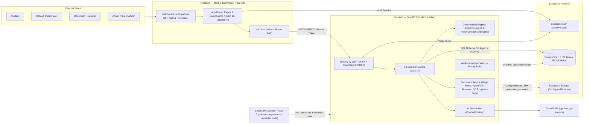

# System Architecture

## Short Explanation

NiyamDrishti is a decoupled full-stack web application: a **Next.js 16 (App Router)** frontend communicates over HTTPS REST with a **FastAPI** modular monolith backend, backed by **Supabase** for PostgreSQL persistence, user authentication, and object storage, plus **OpenAI** for document rule extraction and conversational assistance.

---

## 1. Why This Architecture Exists & What Problem It Solves

Policy intelligence requires both responsive student UX and strict server-side determinism, role-based access control, and verifiable audit trails. Separating the React/Next.js presentation layer from the Python/FastAPI domain layer lets the backend leverage Python's PDF/OCR ecosystem (`PyMuPDF`, `pytesseract`, `python-docx`), Pydantic v2 validation, and pure-Python evaluation engines.

---

## 2. Overall System Architecture Diagram

---

## 3. Architectural Layers

| Layer | Technology | Responsibility | Actual Status |
|---|---|---|---|
| **Presentation** | Next.js `16.4.6`, React `19.3.0`, Tailwind CSS `4.3.3` | Role-aware dashboard, scheme discovery, eligibility checker, ChangeLens, LifeMap, AI chat, reviewer queue | Implemented (several subpages and API contracts still need alignment) |
| **API Gateway & Auth** | FastAPI `0.115.0`, `HTTPBearer`, Supabase `/auth/v1/user` | CORS enforcement, Bearer JWT validation, 5-role RBAC (`RoleChecker`) | Implemented |
| **Domain Modules** | 14 modular routers under `backend/app/modules/` | Schemes, profiles, eligibility, ChangeLens, documents, reviews, LifeMap, applications, assistant, impacts, monitoring | Implemented / Partially Implemented |
| **Deterministic Engines** | Pure Python (`engine.py`, `comparison_engine.py`) | Reproducible eligibility scoring & version diffing | Implemented (2 compound-rule tests failing in `EligibilityEngine`) |
| **AI & Document Parsing** | `PyMuPDF`, `pytesseract`, `python-docx`, `OpenAIProvider` | Text/OCR extraction and Pydantic-validated JSON extraction | Implemented in service/provider; not wired to worker loop |
| **Data Persistence** | PostgreSQL `16` via `SQLAlchemy 2.0` async (`asyncpg`) | 22 tables storing profiles, versioned rules, comparisons, jobs, plans | Models implemented; Alembic `versions/` empty |
| **Storage & Workers** | Supabase Storage buckets; `DocumentProcessingJob` table | Private document storage and async extraction queue | Configured in `config.py` / models; worker & storage calls not wired |

---

## 4. Security & Reliability Notes

- Production disables Swagger/ReDoc/OpenAPI (`/api/docs`, `/api/redoc`, `/api/openapi.json` return `None` when `APP_ENV == "production"`).
- `vercel.json` adds security headers (`X-Frame-Options: DENY`, `X-Content-Type-Options: nosniff`, `Referrer-Policy`, `Permissions-Policy`) and proxies `/api/:path*` to Render.
- No Redis client or rate-limiting middleware is currently active in the backend.

---

## 5. Related Documentation

- [Frontend Architecture](FRONTEND_ARCHITECTURE.md)
- [Backend Architecture](BACKEND_ARCHITECTURE.md)
- [Database Architecture](DATABASE_ARCHITECTURE.md)
- [Data Flow](DATA_FLOW.md)
- [Architecture Summary](../ARCHITECTURE.md)

