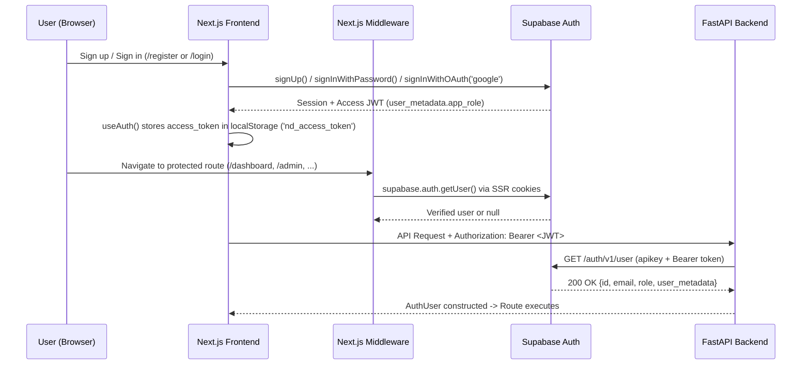

# Authentication

## Short Explanation

NiyamDrishti delegates user registration, login, password management, and Google OAuth to **Supabase Auth**. Neither the Next.js frontend nor the FastAPI backend stores user passwords; instead, the frontend receives a Supabase JWT and sends it as a `Bearer` token to FastAPI, which verifies it against Supabase's `/auth/v1/user` endpoint.

---

## 1. Why This Exists & What Problem It Solves

Building custom password hashing, email verification, and OAuth token rotation from scratch creates unnecessary security liability. Delegating authentication to Supabase Auth provides email verification, Google OAuth, and JWT issuance out of the box, while keeping the backend stateless.

---

## 2. Authentication Sequence Diagram

---

## 3. Technical Implementation

### Frontend Auth Flow

- **Sign Up (`frontend/src/app/(auth)/register/page.tsx`)**:
  - Enforces minimum 8-character password client-side.
  - Calls `supabase.auth.signUp({ email, password, options: { data: { full_name, app_role: "student" } } })`.
- **Login (`frontend/src/app/(auth)/login/page.tsx`)**:
  - Email/password via `supabase.auth.signInWithPassword` and Google OAuth via `supabase.auth.signInWithOAuth`.
  - OAuth exchanges the auth code in `frontend/src/app/auth/callback/route.ts` via `supabase.auth.exchangeCodeForSession(code)`.
- **Session Hook & API Token (`frontend/src/hooks/use-auth.ts`, `frontend/src/lib/api-client.ts`)**:
  - `useAuth()` listens to `onAuthStateChange` and syncs `session.access_token` into `localStorage["nd_access_token"]`.
  - `apiClient` attaches `Authorization: Bearer <token>` on every request and clears the token + redirects to `/login` on `401`.
- **SSR Route Gate (`frontend/src/middleware.ts`)**:
  - Uses `@supabase/ssr` `createServerClient` + `supabase.auth.getUser()` to protect `PROTECTED_PATHS` and `ADMIN_PATHS`, and redirects already-logged-in users away from `/login` and `/register`.

### Backend Token Validation (`backend/app/core/security.py`)

- `bearer_scheme = HTTPBearer(auto_error=False)` extracts the Bearer token.
- `verify_supabase_token(token)` issues an async `httpx` GET request to `{settings.supabase_url}/auth/v1/user` with `Authorization: Bearer {token}` and `apikey: {settings.supabase_anon_key}` (`timeout=10.0`).
- `get_current_user` returns an `AuthUser(user_id, email, role, app_role)` object (`app_role` defaults to `"student"` if missing in `user_metadata`), or raises `401 Unauthorized`.
- `get_optional_user` returns `None` instead of raising `401` on public endpoints (`GET /schemes`).

---

## 4. Known Auth Gaps & Security Observations

1. **No Automatic `user_profiles` Sync**: Supabase Auth creates records in `auth.users`, and `UserProfile.id` must match `auth.users.id`. However, there is currently no DB trigger SQL in the repository and no `/auth/sync` endpoint to insert a `UserProfile` row automatically upon registration (`GET /users/me` returns `404` until a row exists).
2. **`localStorage` Token Storage**: `nd_access_token` is persisted in `localStorage` for Axios client requests, making it readable by JavaScript in the same origin.
3. **Network Call Per Request**: `verify_supabase_token` makes an HTTP call to Supabase on every authenticated FastAPI request rather than verifying JWT signatures locally with JWKS/JWT secret.
4. **Missing Frontend Auth Pages**: `/forgot-password` (linked from `/login`) and `/auth/auth-code-error` (referenced in `/auth/callback`) do not have page files yet.
5. **Phone OTP**: Not implemented; requires Twilio/MSG91/Supabase Phone Auth configuration.

---

## 5. Related Documentation

- [Role-Based Access Control](ROLE_BASED_ACCESS_CONTROL.md)
- [Security](SECURITY.md)
- [User Profile Schema](../05-database-and-api/DATABASE_SCHEMA.md)

