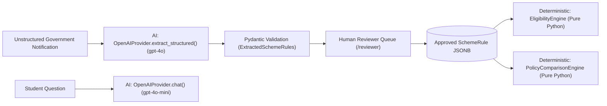

# AI & Intelligence Overview

## Short Explanation

NiyamDrishti uses a strict **separation of responsibilities**: Generative AI handles unstructured language tasks (extracting structured rules from notifications, answering questions, translating explanations), while pure-Python deterministic algorithms execute all eligibility evaluations and policy comparisons.

---

## 1. AI vs. Deterministic Boundary

---

## 2. Configured Models & Providers (`backend/app/core/config.py`)

| Setting | Default Value | Current Code Status |
|---|---|---|
| `ai_provider` | `"openai"` (`openai \| anthropic`) | Only `OpenAIProvider` class is implemented |
| `openai_model` | `"gpt-4o-mini"` | Used by `OpenAIProvider.chat()` and `translate()` |
| `openai_extraction_model` | `"gpt-4o"` | Used by `OpenAIProvider.extract_structured()` |
| `anthropic_model` / `anthropic_extraction_model` | `claude-3-5-haiku-20241022` / `claude-3-5-sonnet-20241022` | Configured in `Settings`, `anthropic` SDK in `requirements.txt`, **provider class not yet implemented** |

---

## 3. Graceful Degradation

`settings.ai_available` checks whether the selected provider's API key is configured. When missing, `POST /api/v1/assistant/chat` returns a clear fallback message without crashing the API, and all deterministic endpoints (`schemes`, `eligibility`, `changelens`, `lifemap`, `applications`, `reviews`) continue operating normally.

---

## Related Documentation

- [Rule Extraction](RULE_EXTRACTION.md)
- [Eligibility Algorithm](ELIGIBILITY_ALGORITHM.md)
- [Policy Comparison Algorithm](POLICY_COMPARISON_ALGORITHM.md)
- [AI Architecture](../03-architecture/AI_ARCHITECTURE.md)

