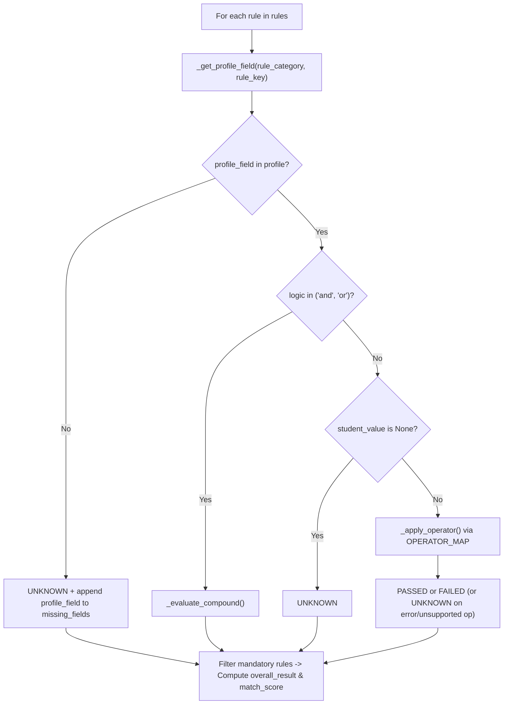

# Eligibility Algorithm

## Short Explanation

The `EligibilityEngine` (`backend/app/modules/eligibility/engine.py`) evaluates a flattened student profile dictionary against a list of approved JSONB rules using deterministic Python operators and returns per-criterion outcomes, missing-field hints, and an overall verdict.

---

## 1. Algorithm Logic



### Supported Operators (`OPERATOR_MAP`)

| Operator | Python Evaluation |
|---|---|
| `lte` / `lt` | `float(a) <= float(b)` / `float(a) < float(b)` |
| `gte` / `gt` | `float(a) >= float(b)` / `float(a) > float(b)` |
| `eq` / `neq` | Case-insensitive string equality (`str(a).lower() == str(b).lower()`) |
| `in` / `not_in` | Case-insensitive membership in list `b` |

*(Note: `contains` and `any` are documented in the docstring but are not in `OPERATOR_MAP`; rules using them return `UNKNOWN`.)*

### Overall Decision & Score

- `failed_mandatory > 0` → `EligibilityResult.FAILED`
- Else if `unknown_mandatory > 0` → `EligibilityResult.UNKNOWN`
- Else if `passed_mandatory == total_mandatory and total_mandatory > 0` → `EligibilityResult.PASSED`
- Else (e.g., 0 mandatory rules) → `EligibilityResult.UNKNOWN`
- `match_score`: `round((passed_mandatory / (passed_mandatory + failed_mandatory)) * 100, 1)` (or `0.0` if denominator is 0).

---

## 2. Known Bug in `_evaluate_compound` (Verified by `pytest`)

In `backend/app/modules/eligibility/engine.py` (lines 249–254):

```python
temp_rule = {
    "rule_category": condition.get("rule_category", "other"),
    "rule_key": sub.get("rule_key", "sub"),
    "condition": sub,
    "is_mandatory": True,
}
```

Because `condition` does not carry `rule_category` and `sub` does not carry `rule_key`, `_get_profile_field("other", "sub")` returns `None`, causing compound `and`/`or` rules to return `UNKNOWN`. This causes `test_compound_and_all_pass` and `test_compound_or_one_passes` to fail (`13 passed, 2 failed`).

---

## Related Documentation

- [Eligibility Engine](../02-product/ELIGIBILITY_ENGINE.md)
- [Test Results](../08-testing-and-quality/TEST_RESULTS.md)

