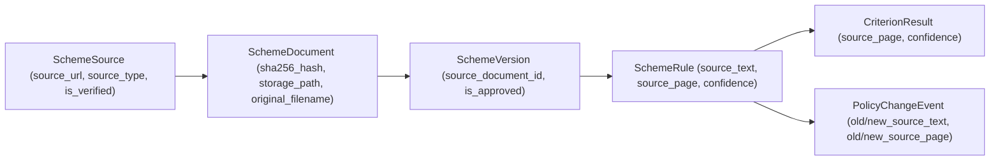

# Evidence and Source Verification

## Short Explanation

Every extracted rule and ChangeLens diff in NiyamDrishti is designed to link back to its official government source—preserving verbatim `source_text`, 1-indexed `source_page`, SHA-256 file hashes, and official URLs so reviewers and students can audit every claim.

---

## 1. Evidence Traceability Chain

---

## 2. Codebase Implementation

- **File Integrity (`documents/service.py`)**: `compute_sha256()` calculates the SHA-256 digest of every uploaded official document (`SchemeDocument.sha256_hash`).
- **Page Markers (`extract_text_from_pdf`)**: Native PDF pages are tagged with `[Page N]` and OCR pages with `[Page N — OCR]`.
- **Rule Anchoring (`SchemeRule`, `ExtractedRule`)**: Stores verbatim `source_text`, `source_page`, and `confidence` (`0.0–1.0`).
- **Evaluation & Diff Propagation**:
  - `eligibility/router.py` returns `source_page` and `confidence` in `CriterionResultOut`.
  - `changelens/router.py` persists and returns `old_source_text`, `new_source_text`, `old_source_page`, and `new_source_page` on `PolicyChangeEvent`.
  - `frontend/src/components/features/changelens/change-event-card.tsx` renders collapsible `
` evidence blocks.

---

## 3. Current Gaps

- `assistant/router.py` returns `sources: []` because RAG retrieval over `SchemeRule` / document chunks is not yet implemented.
- `SchemeSource` model exists in `models/scheme.py`, though no dedicated CRUD endpoints for `scheme_sources` are exposed yet.
- OCR page numbers in `extract_text_from_pdf` are appended after native pages when mixed, and cover-page offsets can differ from displayed PDF viewer page numbers.

---

## Related Documentation

- [Human-in-the-Loop](HUMAN_IN_THE_LOOP.md)
- [Document Review Workflow](../02-product/DOCUMENT_REVIEW_WORKFLOW.md)
- [Known Limitations](../08-testing-and-quality/KNOWN_LIMITATIONS.md)

