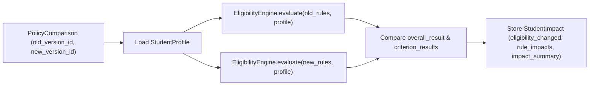

# Impact Analysis

## Short Explanation

Impact analysis evaluates how a policy revision (`PolicyComparison`) alters an individual student's eligibility (`old_eligibility` vs. `new_eligibility`) and stores per-rule explanations in `student_impacts`.

---

## 1. Designed Algorithm & Schema

- **Storage Model (`StudentImpact` in `models/application.py`)**: Stores `student_id`, `comparison_id`, `scheme_id`, `old_eligibility`, `new_eligibility`, `eligibility_changed`, `impact_summary`, `rule_impacts` (`JSONB`), and `is_notified`.
- **Read API (`backend/app/modules/impact/router.py`)**: `GET /api/v1/impacts/me` returns up to 20 most recent `StudentImpact` records for the signed-in student.

---

## 2. Current Implementation Status

> [!NOTE]
> The `StudentImpact` schema and `GET /api/v1/impacts/me` read endpoint are implemented, **but the background/service computation that generates `StudentImpact` rows when a `PolicyComparison` is created is not yet implemented**. Currently, simulation mode (`POST /api/v1/eligibility/evaluate` with `is_simulation=true`) provides single-version profile override testing.

---

## Related Documentation

- [Personalized Impact Engine](../02-product/PERSONALIZED_IMPACT_ENGINE.md)
- [Policy Comparison Algorithm](POLICY_COMPARISON_ALGORITHM.md)

