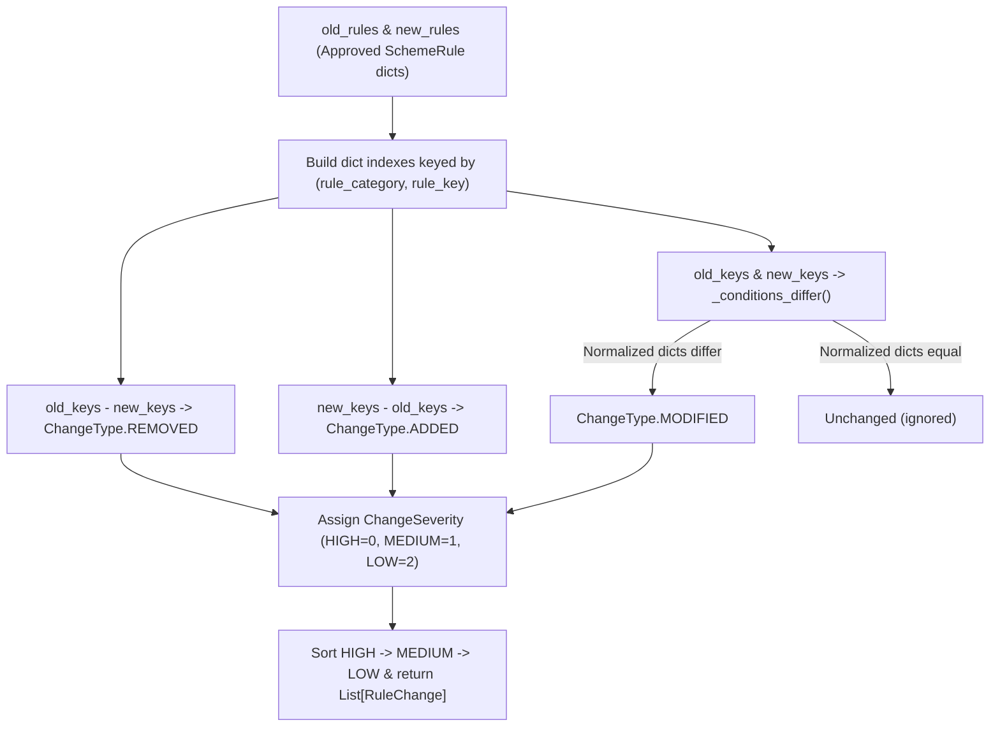

# Policy Comparison Algorithm (ChangeLens)

## Short Explanation

The `PolicyComparisonEngine` (`backend/app/modules/changelens/comparison_engine.py`) deterministically compares two approved `SchemeRule` lists, classifies every difference as `added`, `removed`, or `modified`, assigns `high` / `medium` / `low` severity, and generates plain-English change summaries.

---

## 1. Algorithm Step-by-Step

### Normalization Rules (`_normalize_condition`)

Before comparing two conditions in `old_keys & new_keys`:
1. Excludes the `"note"` key so editorial wording edits do not trigger false modifications.
2. Converts `int`/`float` values to strings.
3. Sorts list values lexicographically as strings (`sorted([str(x) for x in v])`).
4. Lowercases and strips string values.

### Severity Mapping (`_severity`)

| Severity | Rule Categories |
|---|---|
| `HIGH` (`0`) | `income`, `marks`, `cgpa`, `age`, `category`, `disability`, `domicile`, `state`, `exclusion` |
| `MEDIUM` (`1`) | `amount`, `deadline` |
| `LOW` (`2`) | All others (`document`, `renewal`, `course`, `education_level`, `other`) |

---

## 2. Complexity, Edge Cases & Known Limitations

- **Time Complexity**: $O(N + M)$ for indexing and set operations, plus $O(K \log K)$ for sorting $K$ detected changes.
- **Duplicate Keys**: Because `old_index` and `new_index` key strictly on `(rule_category, rule_key)`, duplicate `(category, key)` entries in a single version overwrite earlier ones.
- **Renamed Keys / Different Units**: Renaming a `rule_key` reports `REMOVED` + `ADDED`; equivalent units (`300000 INR` vs. `3 lakh`) report `MODIFIED`.

---

## 3. Verification

All **14 unit tests** in `backend/tests/test_comparison_engine.py` pass.

---

## Related Documentation

- [ChangeLens](../02-product/CHANGELENS.md)
- [Unit Testing](../08-testing-and-quality/UNIT_TESTING.md)

