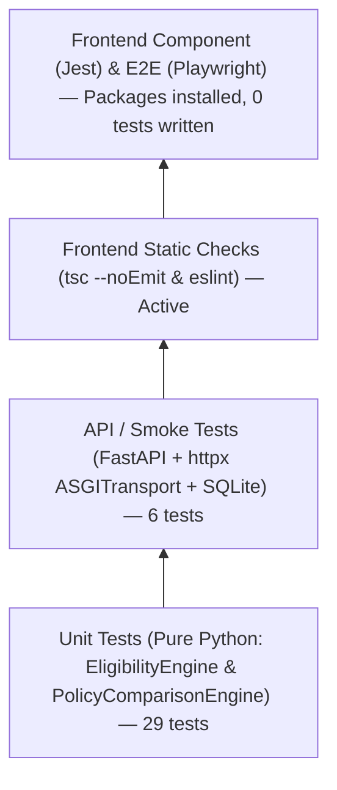

# Testing Strategy

## Short Explanation

NiyamDrishti's testing architecture combines fast in-memory Python unit/smoke tests (`pytest` + `sqlite+aiosqlite:///:memory:`), TypeScript static analysis (`tsc --noEmit`), ESLint, and planned Jest/Playwright suites for UI and end-to-end verification.

---

## 1. Test Pyramid & Current Coverage

| Layer | Tooling | Current Status |
|---|---|---|
| **Backend Pure Unit Tests** | `pytest` (`test_eligibility_engine.py`, `test_comparison_engine.py`) | **29 tests**: 27 pass, 2 fail (compound rules bug) |
| **Backend HTTP Smoke Tests** | `pytest-asyncio` + `httpx.AsyncClient` (`test_health.py`, `test_sanity.py`) | **6 tests**: 6 pass |
| **Backend API Integration Tests** | `tests/integration` (referenced in `ci.yml` `--ignore=tests/integration`) | Directory does not exist yet (`0` tests) |
| **Frontend Static Analysis** | `npx tsc --noEmit`, `npm run lint` | `tsc` passes; `eslint` reports 9 errors, 18 warnings |
| **Frontend Unit & E2E Tests** | `jest`, `@testing-library/react`, `@playwright/test` in `devDependencies` | No test files or npm test scripts exist yet |

---

## 2. How Backend Test Fixtures Work (`backend/tests/conftest.py`)

- Overrides `DATABASE_URL` to `"sqlite+aiosqlite:///:memory:"` and `SUPABASE_URL` to `"https://test.supabase.co"`.
- Creates all 22 ORM tables once per session using `Base.metadata.create_all` (enabled by `app.database.types.JSONB`).
- Yields a rolled-back `AsyncSession` per test and mounts `ASGITransport(app=app)` for HTTP tests.

---

## Related Documentation

- [Unit Testing](UNIT_TESTING.md)
- [API Testing](API_TESTING.md)
- [Frontend Testing](FRONTEND_TESTING.md)
- [Test Results](TEST_RESULTS.md)

