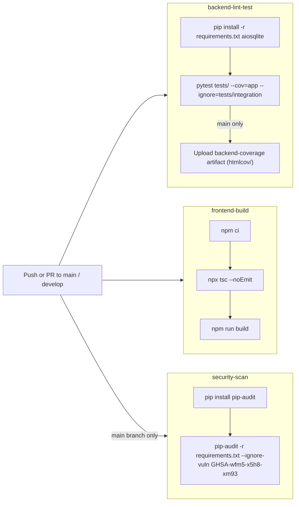

# CI/CD Pipeline

## Short Explanation

GitHub Actions (`.github/workflows/ci.yml`) automatically runs backend unit tests, frontend TypeScript checks, a Next.js production build, and dependency vulnerability scanning—without performing automated cloud deployments itself.

---

## 1. Pipeline Diagram (`.github/workflows/ci.yml`)

---

## 2. Important CI Observations

1. **Checks Only (No CD Job)**: `.github/workflows/ci.yml` does **not** run Vercel or Render deploy steps; deployments are handled independently via GitHub repo integrations when enabled.
2. **Test Condition**: `backend-lint-test` uses `sqlite+aiosqlite:///:memory:` and dummy `SUPABASE_*` test values. Because 2 compound-rule tests in `test_eligibility_engine.py` currently fail locally, this job will fail until `_evaluate_compound` is fixed.
3. **ESLint Not in CI**: `frontend-build` runs `npx tsc --noEmit` and `npm run build` (it does not invoke `npm run lint` explicitly).
4. **Coverage Artifact Path**: On `main`, CI attempts to upload `backend/htmlcov/`, though the `pytest` command uses `--cov-report=term-missing` without `--cov-report=html`.

---

## Related Documentation

- [Deployment Overview](DEPLOYMENT_OVERVIEW.md)
- [Test Results](../08-testing-and-quality/TEST_RESULTS.md)
- [Testing Strategy](../08-testing-and-quality/TESTING_STRATEGY.md)

