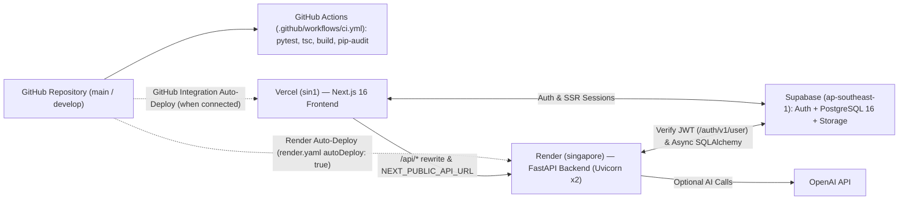

# Deployment Overview

## Short Explanation

NiyamDrishti is configured for a split-cloud deployment: **Vercel** (Singapore `sin1`) for the Next.js 16 frontend, **Render** (Singapore) for the FastAPI backend, and **Supabase** (`ap-southeast-1`) for PostgreSQL 16, Auth, and Storage.

---

## 1. Deployment Architecture Diagram

> [!NOTE]
> `.github/workflows/ci.yml` performs CI checks only (`pytest`, `tsc --noEmit`, `npm run build`, `pip-audit`); it does **not** push or trigger deployments directly. Production deploys rely on Vercel and Render's native GitHub auto-deploy integrations.

---

## 2. Configured Platforms

| Service | Platform | Config File | Region |
|---|---|---|---|
| **Frontend** | Vercel | `frontend/vercel.json` | `sin1` (Singapore) |
| **Backend API** | Render | `backend/render.yaml` | `singapore` (`starter` plan) |
| **Database / Auth / Storage** | Supabase | `backend/.env.example`, `docs/DEPLOYMENT.md` | `ap-southeast-1` |
| **Local Containers** | Docker Compose | `docker-compose.yml`, `backend/Dockerfile` | Local (`api`, `frontend`, `postgres`, optional `redis`) |

---

## Related Documentation

- [Vercel Deployment](VERCEL_DEPLOYMENT.md)
- [Render Deployment](RENDER_DEPLOYMENT.md)
- [CI/CD Pipeline](CI_CD_PIPELINE.md)
- [Docker Architecture](DOCKER_ARCHITECTURE.md)
- [Top-Level Deployment Guide](../DEPLOYMENT.md)

