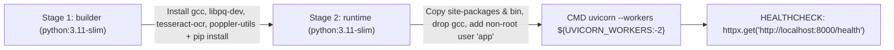

# Docker Architecture

## Short Explanation

NiyamDrishti provides a multi-stage production-style `Dockerfile` for the FastAPI backend (including OCR system packages and a non-root user) and a `docker-compose.yml` file for local full-stack development.

---

## 1. Backend Multi-Stage Dockerfile (`backend/Dockerfile`)

- **Builder Stage**: Installs `gcc`, `libpq-dev`, `tesseract-ocr`, `tesseract-ocr-eng`, `poppler-utils`, and Python packages from `requirements.txt`.
- **Runtime Stage**: Installs runtime-only `libpq5`, `tesseract-ocr`, `tesseract-ocr-eng`, `poppler-utils`, copies installed Python packages, switches to non-root user `app`, exposes port `8000`, and defines a 30s `HEALTHCHECK`.

---

## 2. Local Compose Topology (`docker-compose.yml`)

| Service | Container Name | Volumes / Env | Healthcheck |
|---|---|---|---|
| `api` | `niyamdrishti-api` | `./backend:/app`, `./backend/.env` | `httpx.get('http://localhost:8000/health')` |
| `frontend` | `niyamdrishti-frontend` | `./frontend:/app`, `./frontend/.env` | — |
| `postgres` | `niyamdrishti-postgres` | `postgres_data:/var/lib/postgresql/data` | `pg_isready -U niyamdrishti` |
| `redis` | `niyamdrishti-redis` | — *(optional; unused by backend)* | `redis-cli ping` |

---

## Related Documentation

- [Docker Setup](../07-development/DOCKER_SETUP.md)
- [Render Deployment](RENDER_DEPLOYMENT.md)
- [Document Processing](../03-architecture/DOCUMENT_PROCESSING.md)

