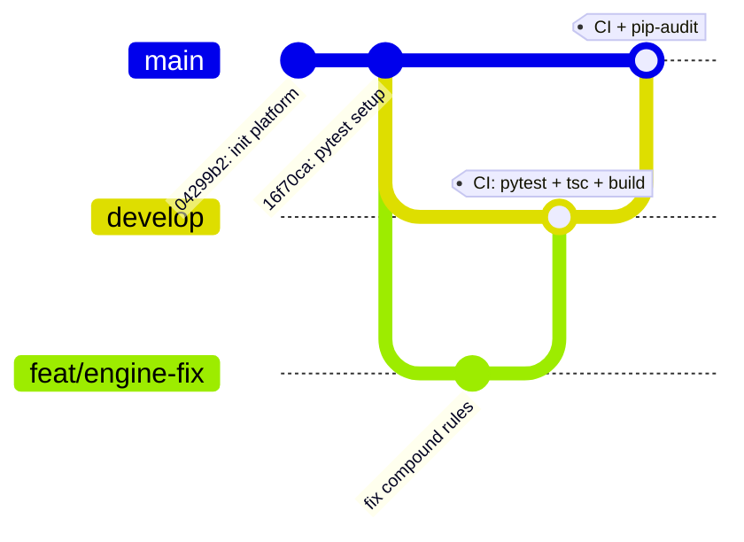

# Development Workflow

## Short Explanation

NiyamDrishti follows a Git branch-and-PR workflow paired with automated GitHub Actions verification targeting `main` and `develop` branches (`.github/workflows/ci.yml`).

---

## 1. Branching & CI Integration Model

As configured in `.github/workflows/ci.yml`, CI runs on pushes and pull requests to `main` and `develop`:



*(Note: The `feat/engine-fix` and `develop` branches above illustrate the intended branching model matching `ci.yml` branch triggers; the current local repo has 4 commits on `main`.)*

---

## 2. Observed Git History

```text
9ec600a feat: add .claude/ to .gitignore
18c5c3c feat: remove deprecated settings files for permissions
16f70ca feat: enhance pytest configuration and add initial test setup
04299b2 feat: initialize NiyamDrishti platform
```

---

## 3. Recommended Change Checklist

1. Create a feature branch from `develop` (or `main`).
2. Update backend/frontend code without breaking deterministic guarantees.
3. Add or update unit/API tests (`pytest`) and verify `npx tsc --noEmit` + `npm run lint`.
4. Update corresponding documentation under `docs/` if routes, models, or behaviors change.
5. Open a pull request targeting `develop` or `main` so GitHub Actions runs validation.

---

## Related Documentation

- [Development Guidelines](../07-development/DEVELOPMENT_GUIDELINES.md)
- [CI/CD Pipeline](../09-deployment-and-devops/CI_CD_PIPELINE.md)
- [Team Overview](TEAM_OVERVIEW.md)

