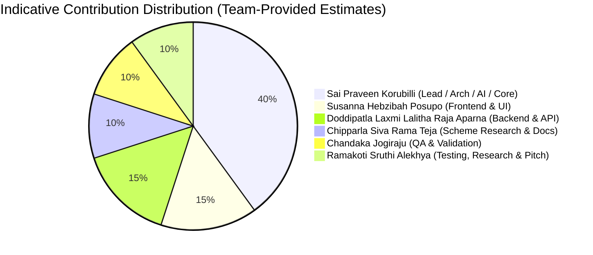

# Individual Contributions

## Short Explanation

This page documents each team member's role focus and the team-reported indicative contribution breakdown across architecture, engineering, policy research, testing, and presentation.

> [!NOTE]
> The contribution percentages below are **team-provided indicative estimates**, not measured Git commit or line-count statistics. (Repository commit history currently consists of 4 consolidated commits under the initial repository setup.)

---

## 1. Indicative Contribution Distribution

| Member | Primary Focus Areas | Indicative Contribution *(Team-Provided Estimate)* |
|---|---|---:|
| **Sai Praveen Korubilli** | Project Lead, System Architecture, AI, Core Backend, Eligibility Engine, ChangeLens, and Integration | 40% |
| **Susanna Hebzibah Posupo** | Frontend Development and UI Integration | 15% |
| **Doddipatla Laxmi Lalitha Raja Aparna** | Backend Development and API Integration | 15% |
| **Chipparla Siva Rama Teja** | Government Scheme Research, Data Preparation, and Documentation | 10% |
| **Chandaka Jogiraju** | Quality Assurance, Functional Testing, and Validation | 10% |
| **Ramakoti Sruthi Alekhya** | Functional Testing, Scheme Research, and Presentation | 10% |
| **Total** | | **100%** |

---

## 2. Visual Distribution *(Team-Provided Estimates)*

---

## 3. Detailed Responsibility Breakdown

- **Sai Praveen Korubilli**: Overall system architecture, FastAPI core infrastructure, AI provider abstraction (`OpenAIProvider`, Pydantic extraction schemas), deterministic `EligibilityEngine` and `PolicyComparisonEngine` (ChangeLens), and cross-system integration.
- **Susanna Hebzibah Posupo**: Next.js 16 App Router pages, Tailwind CSS v4 design system, reusable UI/feature components (`SchemeCard`, `CriterionResult`, `ChangeEventCard`), and frontend API integration.
- **Doddipatla Laxmi Lalitha Raja Aparna**: Backend domain routers, SQLAlchemy 2.0 async models, Supabase Auth verification, and REST API endpoint integration.
- **Chipparla Siva Rama Teja**: Researching Andhra Pradesh, Telangana, and Central government scholarships, preparing structured seed scheme rule datasets (`seed_schemes.py` targets), and supporting documentation.
- **Chandaka Jogiraju**: Quality assurance, functional testing across student/reviewer/admin journeys, and validation of eligibility rule behavior against test scenarios.
- **Ramakoti Sruthi Alekhya**: Functional testing, scheme eligibility research, and hackathon presentation / demo narrative preparation.

---

## Related Documentation

- [Team Overview](TEAM_OVERVIEW.md)
- [Development Workflow](DEVELOPMENT_WORKFLOW.md)
- [Project Milestones](PROJECT_MILESTONES.md)

