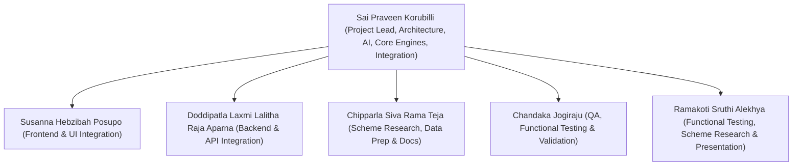

# Team Overview

## Short Explanation

NiyamDrishti is developed by a 6-member student engineering and research team combining full-stack development, AI architecture, government policy research, and quality assurance.

---

## 1. Team Roster & Primary Responsibilities

| # | Team Member | Primary Role & Responsibilities |
|---|---|---|
| 1 | **Sai Praveen Korubilli** | Project Lead, System Architecture, AI, Core Backend, Eligibility Engine, ChangeLens, and Integration |
| 2 | **Chipparla Siva Rama Teja** | Government Scheme Research, Data Preparation, and Documentation |
| 3 | **Chandaka Jogiraju** | Quality Assurance, Functional Testing, and Validation |
| 4 | **Susanna Hebzibah Posupo** | Frontend Development and UI Integration |
| 5 | **Doddipatla Laxmi Lalitha Raja Aparna** | Backend Development and API Integration |
| 6 | **Ramakoti Sruthi Alekhya** | Functional Testing, Scheme Research, and Presentation |

---

## 2. Team Structure Diagram

---

## Related Documentation

- [Individual Contributions](INDIVIDUAL_CONTRIBUTIONS.md)
- [Development Workflow](DEVELOPMENT_WORKFLOW.md)
- [Project Milestones](PROJECT_MILESTONES.md)
- [Hackathon Overview](../11-hackathon/HACKATHON_OVERVIEW.md)

