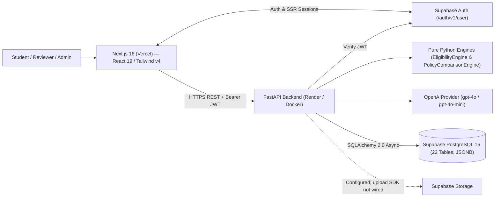

# Architecture Summary

> [!NOTE]
> For detailed per-layer documentation, see [System Architecture](03-architecture/SYSTEM_ARCHITECTURE.md), [Backend Architecture](03-architecture/BACKEND_ARCHITECTURE.md), [Frontend Architecture](03-architecture/FRONTEND_ARCHITECTURE.md), and [Database Schema](05-database-and-api/DATABASE_SCHEMA.md).

---

## System Overview



---

## Core Design Principles

### 1. Deterministic Evaluation, AI Extraction

The eligibility engine (`backend/app/modules/eligibility/engine.py`) and comparison engine (`backend/app/modules/changelens/comparison_engine.py`) are **pure Python** — no LLM calls. This guarantees:

- Reproducible results for the same input
- Auditable logic (every rule evaluation produces an explanation string)
- No hallucinated pass/fail decisions

LLMs (`OpenAIProvider.extract_structured`) are scoped to extracting and structuring rules from documents into Pydantic-validated JSONB conditions (`ExtractedSchemeRules`), which human reviewers approve or reject before rules become active.

### 2. Rule Condition Schema

Extracted eligibility rules are stored as JSONB in `scheme_rules.condition`:

```json
{
  "operator": "lte",
  "value": 300000,
  "unit": "inr",
  "note": "Annual family income limit"
}
```

Supported operators in `EligibilityEngine.OPERATOR_MAP`: `lte`, `lt`, `gte`, `gt`, `eq`, `neq`, `in`, `not_in`. *(Compound `and`/`or` logic is present in `engine.py`, though 2 unit tests currently fail due to sub-condition field mapping.)*

### 3. Schema Versioning

Every uploaded official document creates a `SchemeDocument`, and rules belong to a `SchemeVersion`. `Scheme.latest_version_id` provides fast summary lookups. `PolicyComparison` and `PolicyChangeEvent` persist diffs between two approved versions.

### 4. Auth Model

Authentication is delegated to Supabase Auth. FastAPI validates Bearer tokens remotely via `GET {SUPABASE_URL}/auth/v1/user` (`app/core/security.py`), and enforces 5-role RBAC via `require_roles()` (`app/core/permissions.py`).

### 5. AI Provider Abstraction

`app/ai/providers/base.py` defines the `AIProvider` abstract interface. Currently `openai_provider.py` (`OpenAIProvider`) is implemented; `anthropic` settings exist in `config.py` and `requirements.txt`, with `AnthropicProvider` planned.

---

## Module Structure (14 Routers + Empty Worker Stub)

```text
backend/app/modules/
├── auth/           Auth status endpoint (Supabase handles auth)
├── users/          User profile lookup (/users/me)
├── profiles/       Student academic/demographic profile CRUD
├── schemes/        Scheme listing, search, admin CRUD, bookmarking
├── eligibility/    Deterministic rule evaluation engine + router
├── documents/      File validation, PyMuPDF/OCR/DOCX extraction + upload queue
├── changelens/     Deterministic comparison engine + router
├── impact/         StudentImpact reader (/impacts/me; computation planned)
├── lifemap/        Action plan creation and listing
├── applications/   Manual application status tracking + audit history
├── assistant/      Multilingual OpenAI chat (EN/TE/HI; RAG planned)
├── reviews/        Human review queue for extracted rules
├── notifications/  Placeholder stub (/notifications/me)
└── monitoring/     Admin system-health & job list stub
```

See [Database Schema](05-database-and-api/DATABASE_SCHEMA.md) for all **22 tables** and [Project Audit](PROJECT_AUDIT.md) for exact verification status.
