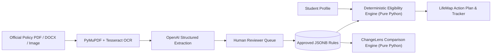

# NiyamDrishti Documentation Hub

> **"Understand policy changes. Discover opportunities. Take the right next step."**

Welcome to the complete technical, architectural, product, and hackathon documentation for **NiyamDrishti** — an AI-powered government policy intelligence and personalized student opportunity platform.

> [!NOTE]
> All documentation in this repository reflects the **actual inspected codebase** as of **2026-11-25**. Where a feature is partially implemented, mismatched, or planned, it is explicitly marked. See the [Project Audit](PROJECT_AUDIT.md) for the complete implementation matrix.

---

## Quick Navigation

| Section | Description | Key Documents |
|---|---|---|
| **Audit & Status** | Codebase verification and documentation tracking | [Project Audit](PROJECT_AUDIT.md) · [Documentation Status](DOCUMENTATION_STATUS.md) |
| **01 — Overview** | Problem, vision, scope, target users, and innovations | [Project Overview](01-overview/PROJECT_OVERVIEW.md) · [Problem Statement](01-overview/PROBLEM_STATEMENT.md) · [Key Innovations](01-overview/KEY_INNOVATIONS.md) |
| **02 — Product** | User journeys, workflows, and feature specifications | [Product Features](02-product/PRODUCT_FEATURES.md) · [ChangeLens](02-product/CHANGELENS.md) · [Eligibility Engine](02-product/ELIGIBILITY_ENGINE.md) · [LifeMap](02-product/LIFEMAP.md) |
| **03 — Architecture** | System, frontend, backend, database, AI, and data flows | [System Architecture](03-architecture/SYSTEM_ARCHITECTURE.md) · [Backend Architecture](03-architecture/BACKEND_ARCHITECTURE.md) · [AI Architecture](03-architecture/AI_ARCHITECTURE.md) |
| **04 — Technical** | Stack, directory layout, auth, RBAC, security, privacy | [Technology Stack](04-technical/TECHNOLOGY_STACK.md) · [Authentication](04-technical/AUTHENTICATION.md) · [Security](04-technical/SECURITY.md) |
| **05 — Database & API** | 22-table PostgreSQL schema, ER model, 25 API endpoints | [Database Schema](05-database-and-api/DATABASE_SCHEMA.md) · [API Reference](05-database-and-api/API_REFERENCE.md) · [Database Migrations](05-database-and-api/DATABASE_MIGRATIONS.md) |
| **06 — AI & Intelligence** | Rule extraction, ChangeLens diffing, HITL, multilingual | [AI Overview](06-ai-and-intelligence/AI_OVERVIEW.md) · [Rule Extraction](06-ai-and-intelligence/RULE_EXTRACTION.md) · [Human-in-the-Loop](06-ai-and-intelligence/HUMAN_IN_THE_LOOP.md) |
| **07 — Development** | Local setup, env vars, Docker, and contributor rules | [Getting Started](07-development/GETTING_STARTED.md) · [Local Setup](07-development/LOCAL_SETUP.md) · [Environment Variables](07-development/ENVIRONMENT_VARIABLES.md) |
| **08 — Testing & Quality** | Test strategy, live test outputs, and known limitations | [Testing Strategy](08-testing-and-quality/TESTING_STRATEGY.md) · [Test Results](08-testing-and-quality/TEST_RESULTS.md) · [Known Limitations](08-testing-and-quality/KNOWN_LIMITATIONS.md) |
| **09 — Deployment & DevOps** | Vercel, Render, GitHub Actions CI, Docker, monitoring | [Deployment Overview](09-deployment-and-devops/DEPLOYMENT_OVERVIEW.md) · [CI/CD Pipeline](09-deployment-and-devops/CI_CD_PIPELINE.md) · [Docker Architecture](09-deployment-and-devops/DOCKER_ARCHITECTURE.md) |
| **10 — Team & Project** | Team roles, contributions, milestones, and roadmap | [Team Overview](10-team-and-project/TEAM_OVERVIEW.md) · [Individual Contributions](10-team-and-project/INDIVIDUAL_CONTRIBUTIONS.md) · [Future Roadmap](10-team-and-project/FUTURE_ROADMAP.md) |
| **11 — Hackathon** | Pitch, live demo script, differentiation, and judge guide | [Hackathon Overview](11-hackathon/HACKATHON_OVERVIEW.md) · [Demo Scenario](11-hackathon/DEMO_SCENARIO.md) · [Judge Presentation Guide](11-hackathon/JUDGE_PRESENTATION_GUIDE.md) |
| **Diagrams & Assets** | Standalone Mermaid `.mmd` sources and screenshot guide | [Diagrams Index](diagrams/system-architecture.mmd) · [Screenshot Checklist](assets/README.md) |

---

## Core Architectural Principles at a Glance

1. **AI Extracts, Python Decides**: LLMs never decide pass/fail eligibility or invent policy diffs. Pure Python engines (`EligibilityEngine`, `PolicyComparisonEngine`) produce reproducible, auditable decisions.
2. **Human-in-the-Loop Gate**: Extracted rules remain `pending` until a `document_reviewer`, `admin`, or `super_admin` approves them.
3. **Evidence Traceability**: Every extracted `SchemeRule` and `PolicyChangeEvent` preserves `source_text` and `source_page`.

---

## Top-Level Legacy Docs

The repository also retains three top-level files in `docs/` that summarize key topics and link into the structured folders:

- [Architecture Summary](ARCHITECTURE.md)
- [Deployment Summary](DEPLOYMENT.md)
- [Known Limitations](KNOWN_LIMITATIONS.md)

